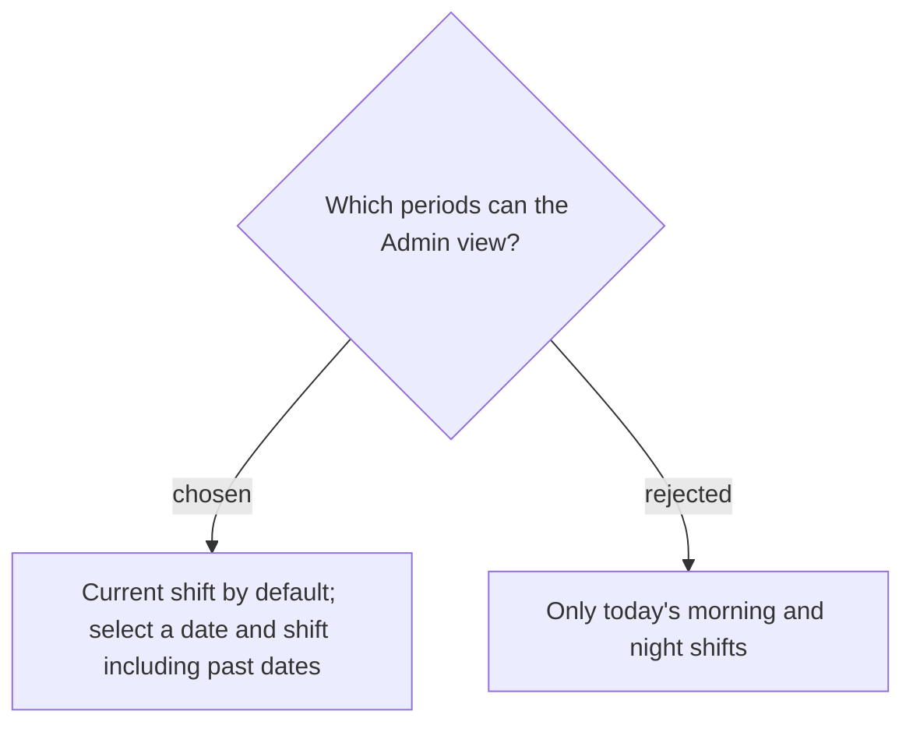

# Overview supports a selected date and shift, defaulting to the current shift

On 2026-11-16 the owner selected B in the interview: the overview opens at the current shift and lets the Admin select a date and morning/night shift, including earlier dates. They can investigate which Areas had no recorded entry, missed cleaning or missed inspection in that selected shift. Drill-through must preserve the selected date and shift, as well as building and Area context where relevant, so following a historical metric does not silently open current-shift work.

Historical display is not yet implemented. Existing Attendance supports shift-date navigation, but the current point Dashboard represents the running shift. Exact historical evaluation, navigation destinations, retention limits and behavior after setup changes must be verified before spec approval; no promise of unlimited history or an exact historical setup snapshot is made here.
