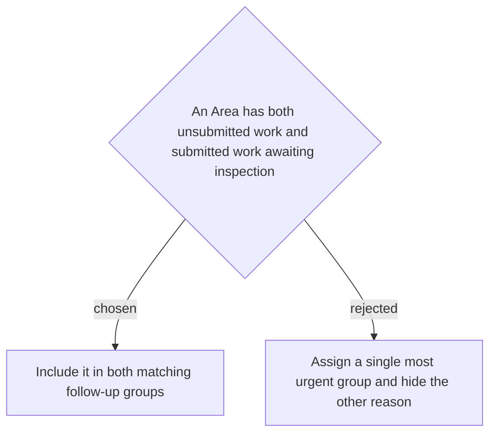

# An Area can appear in multiple follow-up groups

On 2026-11-16 the owner selected A: if an Area has one point not submitted and another submitted point awaiting inspection, it appears in both “ทำไม่ครบ” and “มีงานรอตรวจ.” Count distinct Areas once within each group, while allowing overlap across groups. Each group's drill-through must show the matching Areas and relevant reasons.

Explain visibly that group counts can overlap and cannot be added as a unique factory-wide Area total. A single pie chart whose slices represent these overlapping follow-up groups would be misleading. This decision concerns follow-up groups, not a mutually exclusive completion partition within an individual metric.
