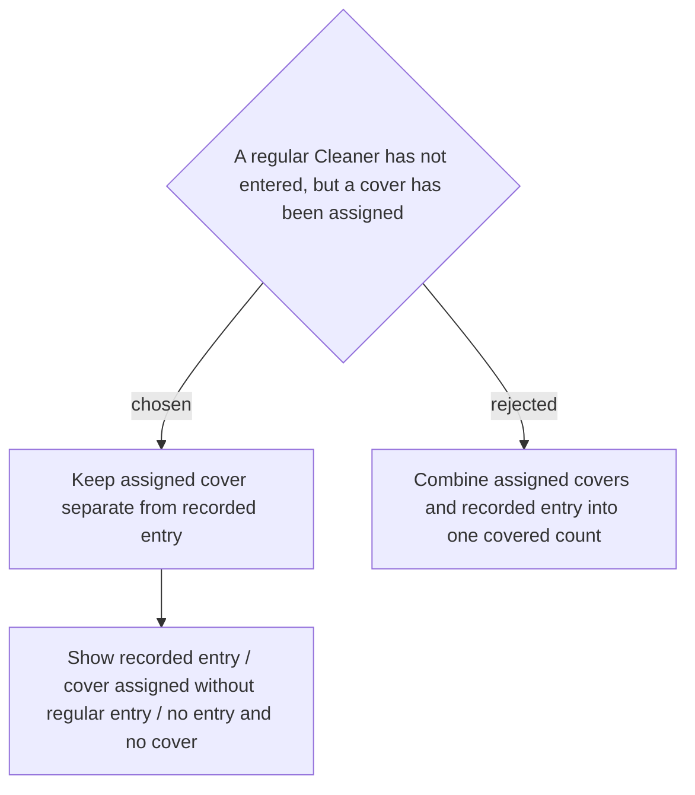

# Coverage distinguishes recorded entry, assigned cover and unassigned Areas

On 2026-11-16 the owner selected A. In the hypothetical example of 100 required Areas, 90 have recorded entry, five more have an assigned cover, and five have neither recorded entry nor an assigned cover. Do not label the combined 95 as Areas that entered. Assignment alone does not prove physical entry at the target Area.

For the entry overview, the three categories partition distinct Areas: regular recorded entry (including subsequent break/shift-out), no regular entry with an active cover assignment, and no regular entry without an active cover assignment. The “no recorded entry” drill-through can include the latter two categories, ten Areas in this example, with each row showing assignment status. A cover on an Area whose regular Cleaner has entered must not cause the Area to count twice. No new cover-specific target-Area check-in workflow is authorized by this display decision.
