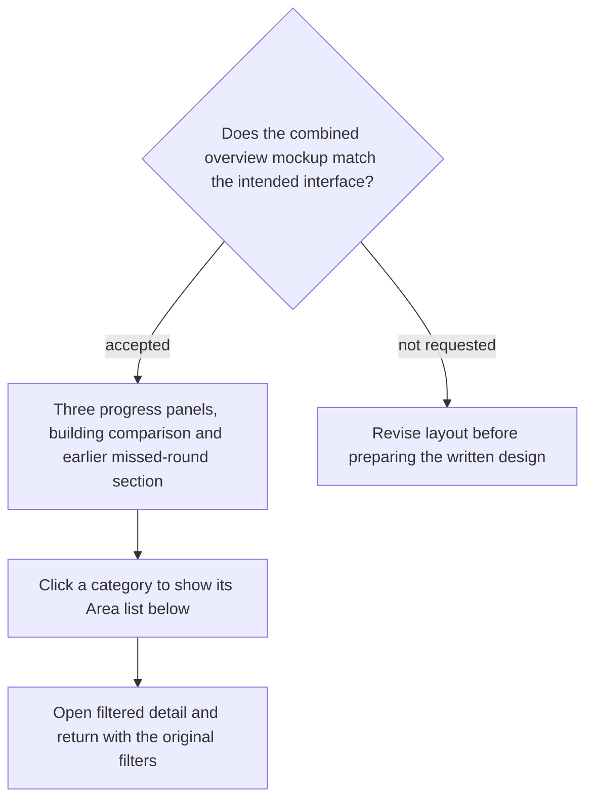

# Combined overview mockup layout and drill-through are accepted

On 2026-11-16 the owner said “โอเคชอบเลยครับ” after reviewing the interactive overview mockup. The accepted visual proposal uses the existing Enterprise Light design, date/shift/building controls, entry/cleaning/inspection progress, per-building comparison, overlapping follow-up categories, earlier missed-round outcomes and a matching Area list below the overview. Selecting an Area opens its filtered detail preview and Back preserves the filters.

Source of the accepted preview: `/Users/macbookair/.codex/visualizations/2026/11/16/01a1e200-ca3c-7c62-9a26-60b1ec6ac403/facility-overview.html`. The numbers and destination screens are synthetic proposals, not implemented application behavior. The owner immediately instructed: do not implement yet; explain the intended work first. Mockup acceptance is not approval to change application code or the database. Remaining counting/history details and the mandatory design recap must be resolved before the written spec; spec approval precedes the implementation plan under `grill-then-plan`.
