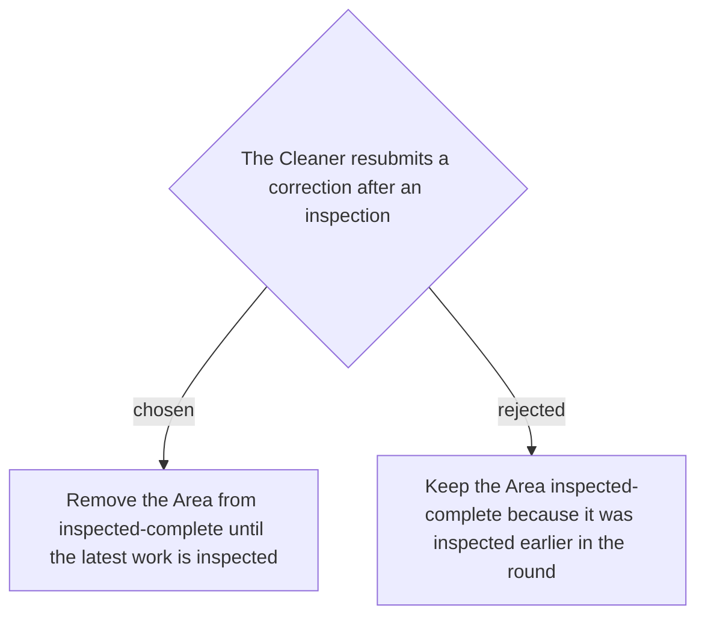

# Inspection completion follows the latest submitted work

On 2026-11-16 the owner selected B in the interview: the overview's inspection completion follows the latest submitted work. An Area with all five points inspected, including one Rework result, initially counts as inspected-complete under facility-0119. Once the Cleaner submits the correction, it no longer counts as inspected-complete until that latest work is inspected. The earlier inspection remains in history.

This resolves the resubmission question left open in [facility-0119](facility-0119-overview-inspection-count-measures-coverage.md). It aligns with the existing `PointStatusCalculator` behavior: a submission newer than the latest inspection returns the point to PendingInspection. A Rework result is an inspection, but an old inspection cannot certify newly submitted work. The new overview does not change submission or inspection workflows.
