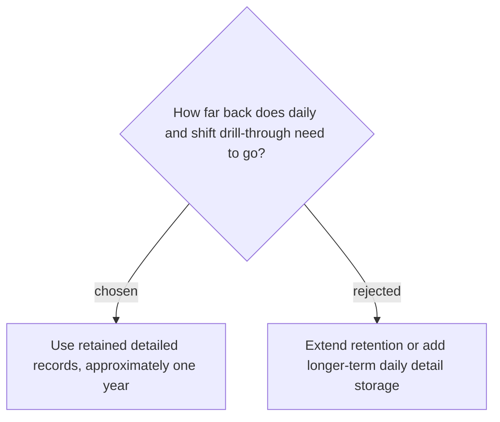

# Overview history stays within the retained detailed-data window

On 2026-11-16 the owner selected A: date/shift history uses the period for which the system still retains the required detailed data, approximately one year. Do not extend the existing retention policy for this overview. The UI must expose the available date range and must not turn missing or archived details into zero activity or absent staff.

Existing retention uses a calendar-year cutoff for attendance and whole-month archiving for older submission/inspection records; therefore one common daily drill-through range must be derived from completeness rather than promising every record for exactly 365 days. Anonymous monthly point summaries do not supply daily Area/people lists. This decision limits history length; target fidelity after setup changes remains a separate question.
