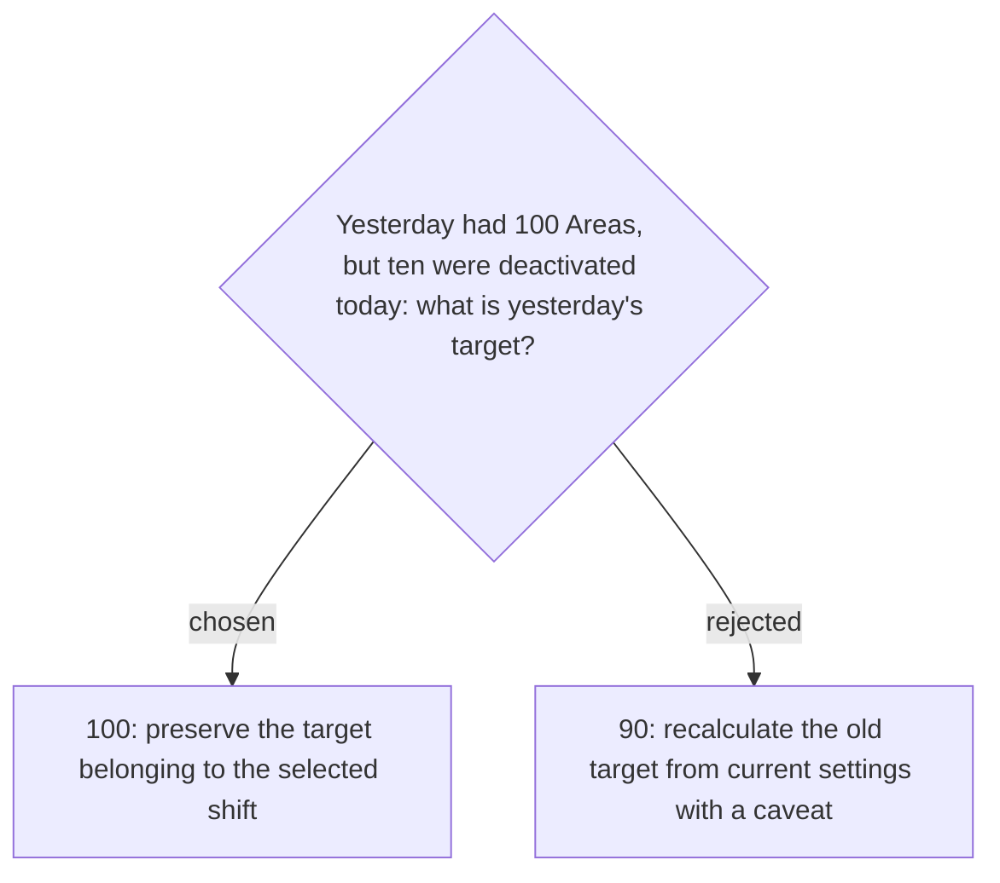

# Historical overview preserves the selected shift's target

On 2026-11-16 the owner selected A: later Area deactivation or schedule changes must not rewrite earlier shift targets. The agreed example retains yesterday's target of 100 Areas when ten are deactivated today. The owner accepted that this requires additional target-history capture starting with the feature. For earlier periods, show only verifiable information and explicitly identify incomplete target history; do not invent an accurate historical target from current configuration.

Capture must cover the target facts needed for staffing, cleaning and inspection counts, including Area eligibility, Service Points and round schedules. This decision does not choose a storage layout or freeze targets at shift start; the spec must explain how relevant configuration changes are captured without altering existing operational workflows. The historical-detail limit in [facility-0126](facility-0126-overview-history-uses-retained-detail-window.md) remains: this is not authorization to extend retention.

This is an accepted design requirement, not permission to implement or migrate the database. The owner's implementation hold remains in force.
