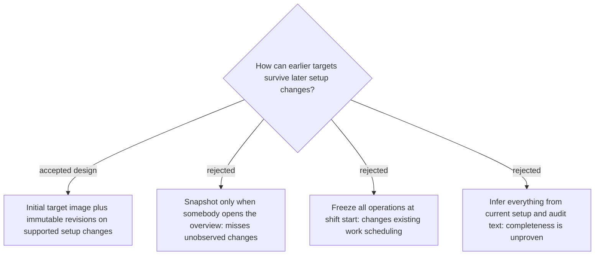

# Preserve shift targets through atomic configuration revisions

Accepted as the design basis for planning on 2026-11-16: after receiving the spec, the owner invoked `sp-writing-plans`. This accepts the approach for the implementation plan; the owner’s explicit implementation hold remains in force. Capture a complete structural target image after initialization and a new revision in the same transaction as every supported Building, Area, Service Point or Round Window mutation. Revisions include stable IDs, labels, eligibility, ownership, windows and effective receiving-policy settings, without account secrets, personnel names, QR tokens or GPS. Capture receiving-policy changes at startup so later settings do not move an older slot's recorded closing boundary. Derive a selected shift from the revision timeline and operational records; no daily scheduler or immutable result totals are required.

Use an immutable revision table with a schema-versioned JSON image and a singleton serialization row. A shared setup-mutation coordinator owns locking, the existing mutation/audit, revision capture and commit. Do not hook every intermediate `SaveChanges` or alter scan/inspection scheduling. Targets follow changes while the selected slot still accepts work; revisions after its receiving window closes cannot rewrite it. Verified existing behavior: Cleaner submissions use their own shift with `AttendanceCalendar`'s after-shift window, while Supervisor inspections use the clock's shift. Therefore final target/outcome sealing follows the receiving-window close, not just 07:00/19:00. Initial capture does not prove configuration before capture began. See [the design](../superpowers/specs/2026-11-16-combined-overview-dashboard-design.md).
