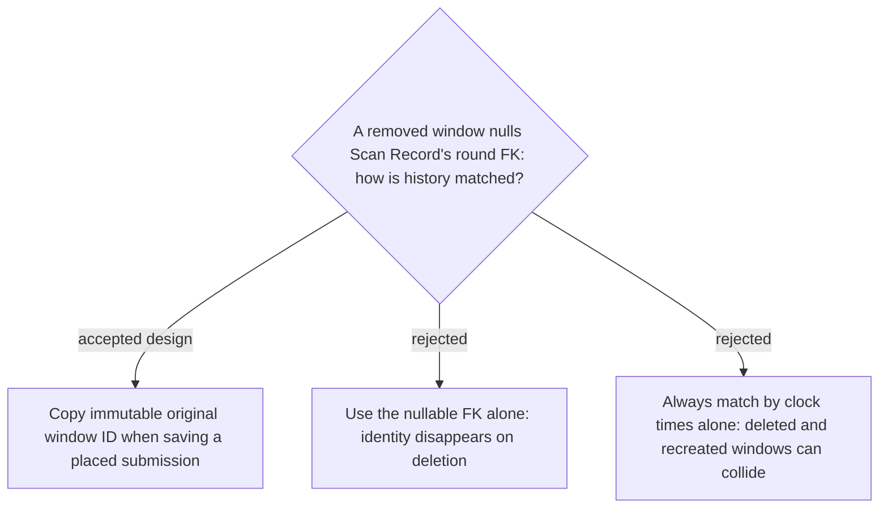

# Keep a round's origin identity after its editable window is removed

Accepted as the design basis for planning on 2026-11-16: after receiving the spec, the owner invoked `sp-writing-plans`. This accepts the approach for the implementation plan; the owner’s explicit implementation hold remains in force. Add a nullable, immutable, non-FK round-origin field to Scan Record, populated by the server from the placed round. The existing nullable `RoundWindowId`, copied times and placement rules remain intact. Backfill only demonstrable identities from still-present FKs; unknown legacy identities stay unknown. The origin field plus point and shift slot matches records to the captured target revisions even after window removal or recreation at identical clock times.

No new client input or global validation requirement is introduced. Legacy and off-round paths may leave the field null; the overview uses a safe existing-FK or uniquely provable history match, otherwise marks historical completeness as partial. No new records extend source retention. See [the design](../superpowers/specs/2026-11-16-combined-overview-dashboard-design.md).
