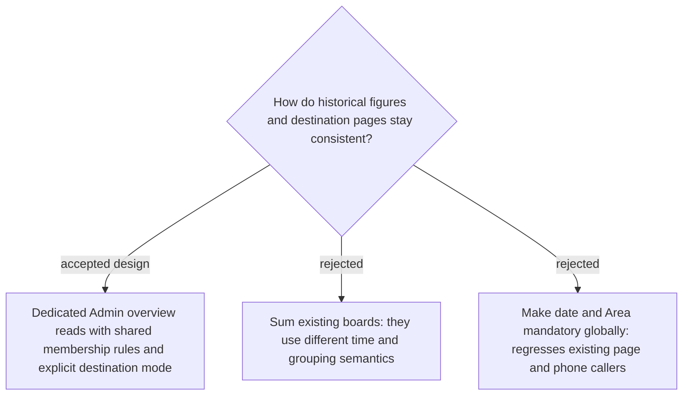

# Overview counts, Area lists and detail share one scoped read model

Accepted as the design basis for planning on 2026-11-16: after receiving the spec, the owner invoked `sp-writing-plans`. This accepts the approach for the implementation plan; the owner’s explicit implementation hold remains in force. New Admin-only overview summary, Area-list and Area-detail reads share the same projection, group predicates and target-history version. Add `/admin/overview` and explicit overview drill-through modes on the existing Attendance and point Dashboard routes; normal links and endpoint contracts retain their current behavior. Supervisor inspection summary remains a per-person report and is not reused as an Area metric.

Date/shift, building, Area, group and return context are explicit URL state. Only overview-mode reads validate the new historical context. Unavailable history returns availability metadata and unknown counts, never an unfiltered current board. This adds a read path and preserves existing operational write authorization. See [the design](../superpowers/specs/2026-11-16-combined-overview-dashboard-design.md).
