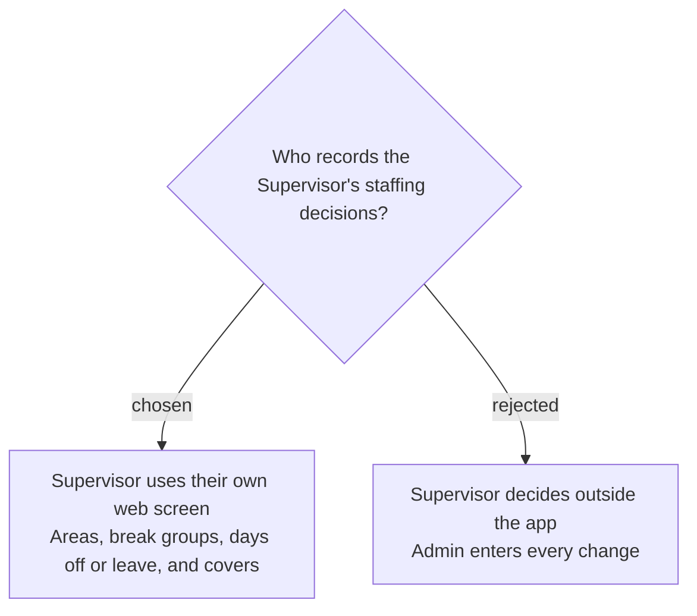

# Supervisor manages Cleaner schedules directly in the web app

On 2026-11-16 the owner selected A: Supervisors must have a web screen to arrange and record Cleaners' Area assignments, break groups, days off or leave, and substitutes themselves. This follows the owner's new field requirements from a Supervisor. Requiring Admin to enter every Supervisor decision was rejected so that the person arranging the work can record it directly.

This extends the inspection-focused Supervisor role in [facility-0048](facility-0048-supervisor-assigned-to-building.md) and amends the Admin-only assignment authority in [facility-0041](facility-0041-scan-only-own-area-with-cover-assignment.md) for the new Cleaner scheduling design. It does not grant Supervisors general account administration or authority to assign inspection covers for other Supervisors.

The Supervisor's permitted buildings and shifts were subsequently resolved in [facility-0132](facility-0132-supervisor-scheduling-scoped-to-own-building-and-shift.md): only their own assigned building and shift. [facility-0133](facility-0133-admin-manages-schedules-across-buildings-and-shifts.md) subsequently confirms Admin may manage all buildings and shifts, with change history. Approval rules, assignment duration, and scheduling/attendance details remain unresolved. Existing application permissions remain unchanged until implementation. This is an accepted design decision, not a completed feature; the session continues through mockup, decision recap, written spec approval and implementation planning under `grill-then-plan`.
