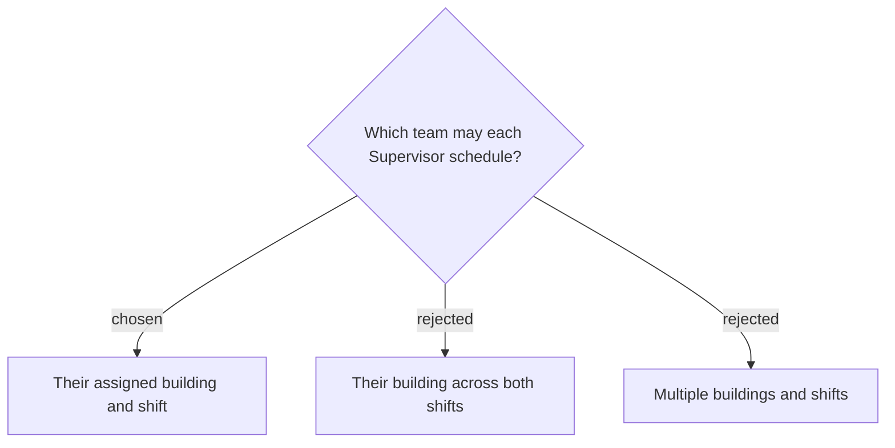

# Supervisor schedules only their own building and shift

On 2026-11-16 the owner selected A: the scheduling screen accepted in [facility-0131](facility-0131-supervisor-manages-cleaner-schedules-in-web.md) permits each Supervisor to manage Cleaner Area assignments, break groups, days off or leave, and substitutes only within their own assigned building and shift. For example, the Supervisor of building A's day shift manages that team; another building or the night shift belongs to its responsible Supervisor.

This defines the team being managed, not a requirement that the Supervisor may edit schedules only while their shift is running. Advance scheduling and effective dates still need clarification. Cross-team borrowing of substitutes and how responsibility changes affect existing schedules remain open. [facility-0133](facility-0133-admin-manages-schedules-across-buildings-and-shifts.md) subsequently confirms Admin may manage all buildings and shifts with change history. It does not grant scheduling rights through an inspection Cover Assignment.

This is an accepted design decision extending [facility-0048](facility-0048-supervisor-assigned-to-building.md); no application permission, endpoint, schema or runtime has been changed.

**Scope amendment:** [facility-0140](facility-0140-supervisor-may-schedule-multiple-assigned-buildings.md) supersedes the assumption of exactly one assigned building per Supervisor. A Supervisor may manage multiple assigned buildings and assign relief work between them. This decision's responsibility boundary now means the assigned building set and their own shift, not unrestricted access to other buildings or shifts.

**Relief mobility clarification:** [facility-0139](facility-0139-relief-cleaners-may-work-across-buildings.md) permits relief Cleaners to work across buildings. This does not widen the Supervisor's own-building-and-shift management scope. Who records or approves such assignments remains under discussion.
