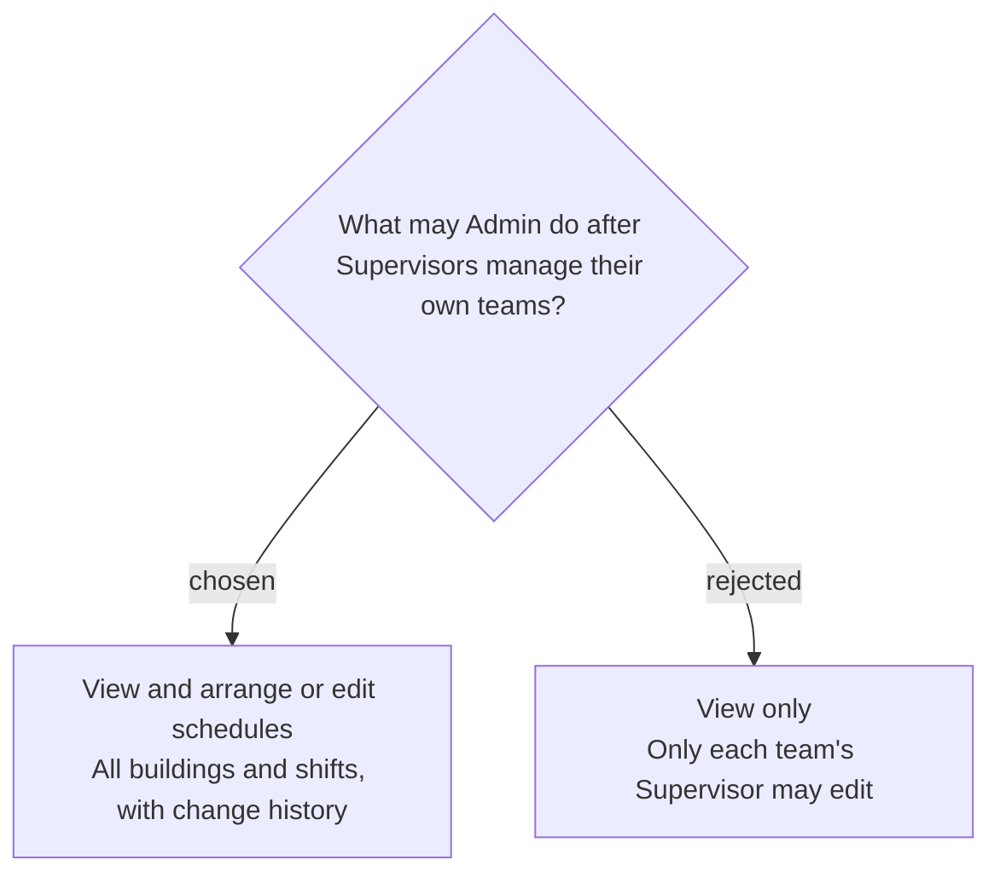

# Admin manages Cleaner schedules across all buildings and shifts

On 2026-11-16 the owner selected A: Admin may view and arrange or edit Cleaners' Area assignments, break groups, days off or leave, and substitutes across all buildings and shifts. Schedule changes must retain history identifying who changed what. This lets Admin help when a Supervisor is unavailable or coordination spans teams.

This complements the Supervisor's own-building-and-shift scope in [facility-0132](facility-0132-supervisor-scheduling-scoped-to-own-building-and-shift.md) and the direct scheduling screen in [facility-0131](facility-0131-supervisor-manages-cleaner-schedules-in-web.md). It does not widen Supervisor permissions, establish eligibility for cross-team substitutes, or authorize rewriting recorded attendance. Approval, concurrent edits, effective dates and detailed change-history presentation remain to be designed.

This is an accepted design decision. No application permissions, endpoints, schema or runtime have been changed.
