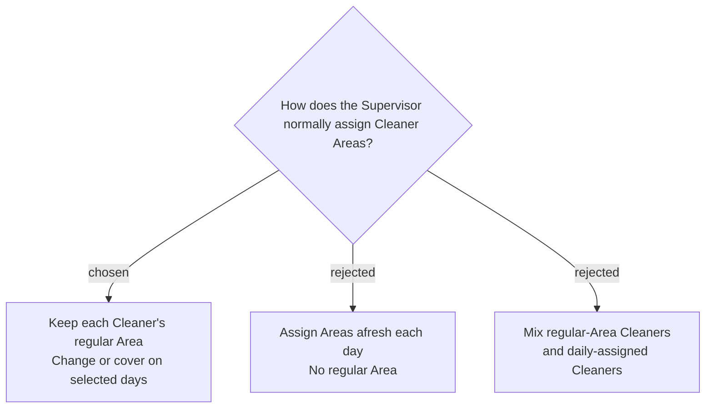

# Cleaners retain regular Areas with exceptions on selected days

On 2026-11-16 the owner selected A: Cleaners have regular Areas, and the Supervisor changes the Area or assigns cover only on selected days. The scheduling screen must not require the Supervisor to recreate routine Area assignments every day. This retains the regular-Area principle in [facility-0040](facility-0040-area-is-the-unit-of-assignment.md) while allowing dated exceptions in the new scheduling design.

This does not settle whether a temporary Area change replaces or adds to the person's normal work, the duration of a cover, staffing cardinality, which QR sign a reassigned Cleaner uses, or eligibility to borrow a person from another team. Those details require separate questions. The scheduling authority and scope in [facility-0131](facility-0131-supervisor-manages-cleaner-schedules-in-web.md), [facility-0132](facility-0132-supervisor-scheduling-scoped-to-own-building-and-shift.md) and [facility-0133](facility-0133-admin-manages-schedules-across-buildings-and-shifts.md) remain in force.

This is an accepted design decision; no application, schema, database or runtime changes have been made.

**Scope clarification:** [facility-0137](facility-0137-dedicated-relief-cleaners-cover-days-off.md) subsequently establishes dedicated relief Cleaners with no regular Areas. This decision describes regular Cleaners, not every person in the workforce; its earlier rejection of mixed arrangements must not be used to exclude the relief pool. Daily reallocation of regular staff remains unnecessary.
