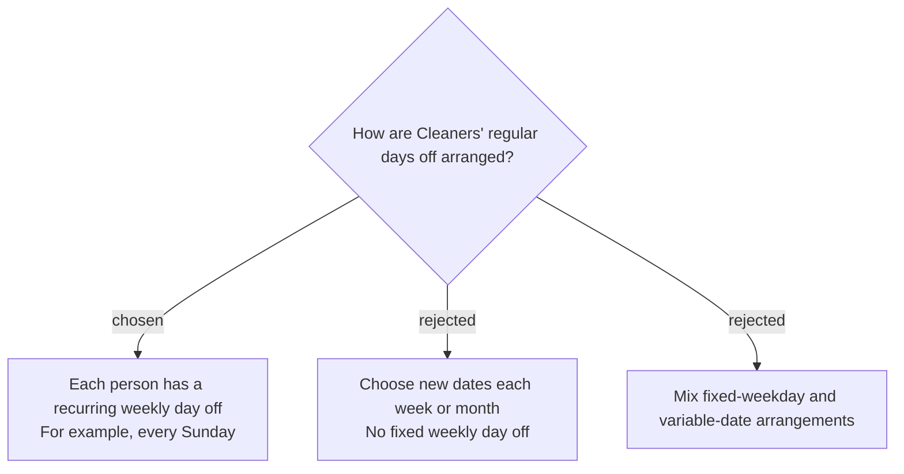

# Cleaners have recurring weekly days off

**Scope superseded on 2026-11-17:** [0190](facility-0190-supervisor-selects-cleaner-days-off-by-week.md) records the owner's actual-work clarification: the Supervisor may select a different weekday off in each week. Repeating the usual weekday is common but not mandatory for the whole month. The fixed-only restriction and rejection of variable weekly arrangements below are historical; they must not block week-specific editing. Automatic copying/default behavior remains unchosen.

On 2026-11-16 the owner confirmed that each Cleaner has a regular day off on a fixed weekday, such as every Sunday. The scheduling design must represent that recurring weekly pattern rather than require all regular days off to be entered again as individual dates. The example does not assign Sunday to everyone or establish a specific number of days off.

The owner first asked what changing a day off on selected dates meant. After a concrete example, the question was rephrased to ask about actual weekly practice, and the owner selected the fixed-weekday option. Therefore this decision confirms recurring weekly days off only; swapping a day off for a particular week remains unresolved.

This amends the exclusion of individual day-off schedules in [facility-0050](facility-0050-check-in-confirms-area-presence-not-time-attendance.md). Supervisor and Admin scheduling authority follows [facility-0131](facility-0131-supervisor-manages-cleaner-schedules-in-web.md), [facility-0132](facility-0132-supervisor-scheduling-scoped-to-own-building-and-shift.md) and [facility-0133](facility-0133-admin-manages-schedules-across-buildings-and-shifts.md). [facility-0136](facility-0136-regular-day-off-keeps-all-area-cleaning-rounds.md) subsequently confirms the Area still requires all usual rounds and the Supervisor arranges a substitute. Effective dates, leave, one-off changes, night-shift date attribution and detailed substitute arrangements remain to be clarified. This decision does not introduce payroll calculations or change retention.

Accepted design only; no application, schema, database or runtime changes have been made.
