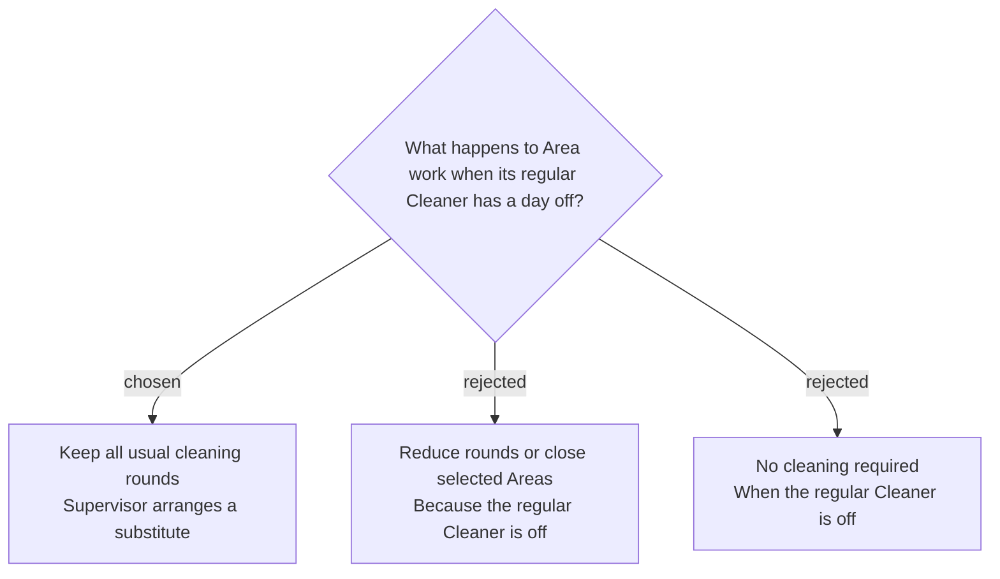

# A Cleaner's regular day off keeps all Area cleaning rounds

On 2026-11-16 the owner selected A: when a Cleaner takes their recurring weekly day off, their Area still requires all usual cleaning rounds, and the Supervisor arranges a substitute. A person's regular day off must not automatically close the Area, reduce its required rounds, or mark the work complete. This complements [facility-0135](facility-0135-cleaners-have-recurring-weekly-days-off.md) and preserves the separation between personal days off and Area work in [facility-0050](facility-0050-check-in-confirms-area-presence-not-time-attendance.md).

The dashboard must continue to represent the Area's required work on that day. A substitute assignment alone is not evidence of physical entry, submission or inspection; the distinction in [facility-0123](facility-0123-overview-separates-entry-cover-and-unassigned.md) remains relevant when reviewing the overview design.

[facility-0137](facility-0137-dedicated-relief-cleaners-cover-days-off.md) subsequently confirms dedicated relief Cleaners without regular Areas provide the cover, rather than regular Cleaners taking on an additional Area. Relief eligibility and duration, recurring cover arrangements, and behavior before a substitute is assigned remain unresolved. This decision does not select a scanning flow, enforce assignment before saving a day off, or define a separate Area-closure feature.

Accepted design only; no application, schema, database or runtime changes have been made.
