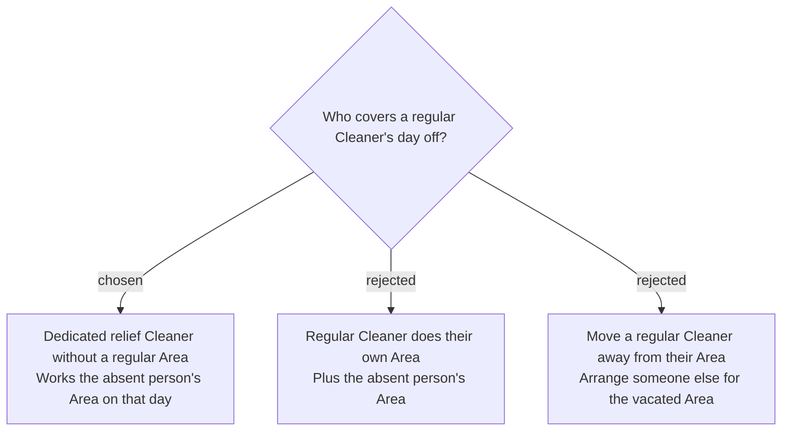

# Dedicated relief Cleaners without regular Areas cover days off

On 2026-11-16 the owner clarified that substitutes are dedicated relief Cleaners, called “แม่บ้านสำรอง” or “สแปร์”, who have no regular Areas. They work in place of regular Cleaners on the days those people are off. For example, a relief Cleaner covers A on Monday and B on Tuesday when those are A's and B's days off. It is not the arrangement where another regular Cleaner handles their own Area as well as an additional Area.

This supersedes the no-relief-staff/additional-work assumption in [facility-0041](facility-0041-scan-only-own-area-with-cover-assignment.md) and the corresponding amendment in [facility-0040](facility-0040-area-is-the-unit-of-assignment.md) for the new scheduling design. It clarifies that the regular-Area decision in [facility-0134](facility-0134-cleaners-retain-regular-areas-with-dated-exceptions.md) applies to regular Cleaners and does not exclude a separate relief pool. All usual Area rounds remain required under [facility-0136](facility-0136-regular-day-off-keeps-all-area-cleaning-rounds.md).

Relief Cleaners' building/shift scope, selection and recurring assignments, maximum concurrent Areas, partial versus full-shift cover, their own days off, and their QR/attendance flow remain unresolved. This does not decide a new authentication role or storage representation. Do not temporarily rewrite a relief person's regular Area merely to bypass existing scan checks without resolving the assignment design.

Read-only verification: `AccountChecks.ReadPlaceAsync` already accepts a Cleaner with a shift and no Area. However, `CoverAssignmentEndpoints.ListCandidatesAsync` excludes people without an Area, and `AttendanceEndpoints.RecordAsync` rejects any sign whose Area differs from `user.AreaId`, so a person with no regular Area cannot check in through that flow. Existing account support alone does not provide a working relief workflow.

Accepted design only; no application, schema, database or runtime changes have been made.

**Design extension:** [facility-0138](facility-0138-relief-cleaners-receive-six-days-of-assigned-work.md) subsequently clarifies that relief staff receive six days of assigned work per week. If recurring absence cover fills only five days, the Supervisor assigns another Area on the remaining day. Relief work is therefore not limited to that initial set of absences. [facility-0139](facility-0139-relief-cleaners-may-work-across-buildings.md) subsequently permits work in another building. Shift scope, assignment authority across teams, and the nature of additional Area duties remain open.

**Regular-shift clarification:** [facility-0143](facility-0143-relief-cleaners-keep-a-regular-shift.md) confirms that relief Cleaners have a regular shift. Moving between buildings does not allow selecting a different shift for each date. Assignment duration and Area capacity within a shift remain open.
