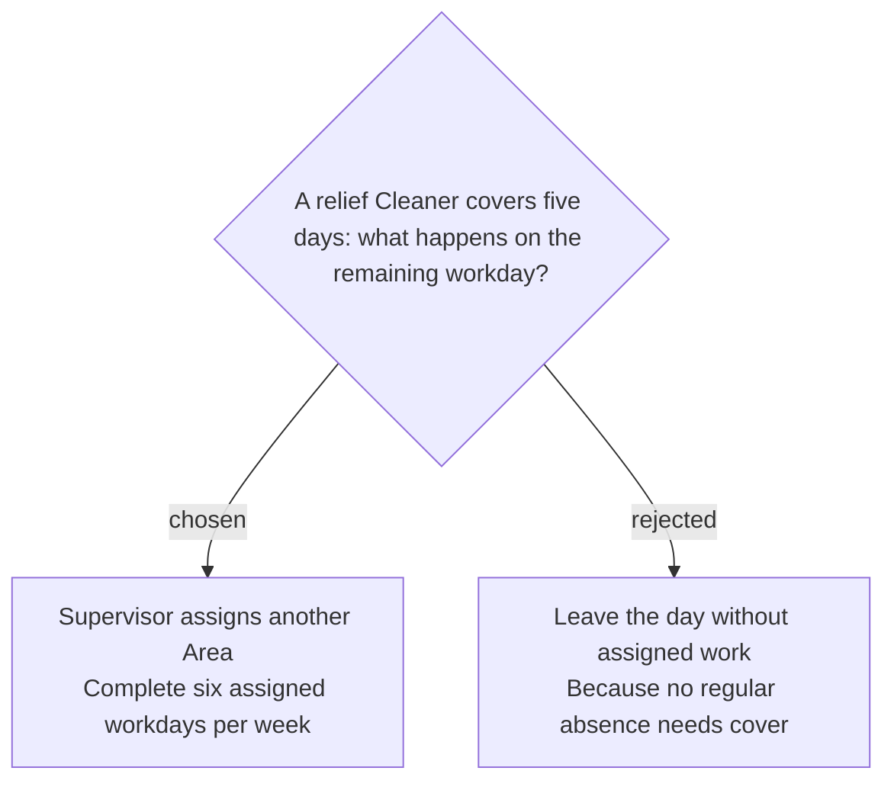

# Relief Cleaners receive six days of assigned work per week

On 2026-11-16 the owner explained that a relief Cleaner must have work assigned for six days per week. For example, covering absences in five Areas accounts for five days; the Supervisor must assign another Area on the remaining workday so the relief Cleaner has six working days. The five-Area example is hypothetical, not a factory-wide Area count or a limit of five cover assignments.

This extends [facility-0137](facility-0137-dedicated-relief-cleaners-cover-days-off.md): a relief Cleaner's schedule includes covering regular days off and other Area duties needed to fill the remaining workday. Their work is not limited to the initial set of regular absences. A scheduled workday is not evidence that someone actually entered, submitted or inspected an Area.

[facility-0139](facility-0139-relief-cleaners-may-work-across-buildings.md) subsequently confirms the other Area may be in another building. The relief Cleaner's shift, whether an extra assignment can help an already staffed Area, and which weekday they take off remain unresolved. Supervisor scope in [facility-0132](facility-0132-supervisor-scheduling-scoped-to-own-building-and-shift.md) remains unchanged until a separate decision resolves cross-team coordination.

This establishes the intended weekly staffing pattern, not a rule to reject saving an incomplete draft, automatically choose a sixth Area, count wages or calculate OT. Effective dates, leave and exception handling remain open. Accepted design only; no application, schema, database or runtime changes have been made.
