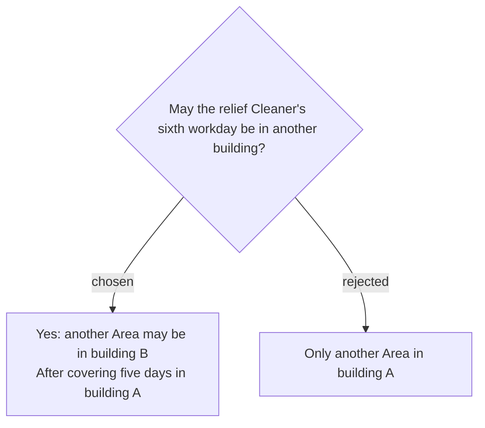

# Relief Cleaners may receive work in another building

On 2026-11-16 the owner selected B in the interview: a relief Cleaner may receive an Area assignment in another building. In the example from [facility-0138](facility-0138-relief-cleaners-receive-six-days-of-assigned-work.md), after working five days of cover in building A, the remaining workday may be assigned in building B. The diagram labels the selected behavior rather than preserving the interview's option letters.

This resolves building mobility for relief staff. It does not decide whether relief staff formally belong to a home building, permit cross-shift work, grant Supervisors management rights over other buildings, or specify who records or approves a cross-building assignment. The own-building-and-shift Supervisor scope in [facility-0132](facility-0132-supervisor-scheduling-scoped-to-own-building-and-shift.md) and Admin's wider authority in [facility-0133](facility-0133-admin-manages-schedules-across-buildings-and-shifts.md) remain in force.

Next resolve who records the assignment when the relief Cleaner moves from A to B, then availability/conflict checks and any approval or notification workflow. An Area assignment alone remains distinct from actual attendance and submitted work. Accepted design only; no application, schema, database or runtime changes have been made.

**Assignment clarification:** [facility-0140](facility-0140-supervisor-may-schedule-multiple-assigned-buildings.md) confirms that one Supervisor may be responsible for multiple buildings and can assign the relief Cleaner between those buildings. The source/destination distinction does not imply two separate Supervisors. Coordination between genuinely different responsible Supervisors remains open.

**Regular-shift clarification:** [facility-0143](facility-0143-relief-cleaners-keep-a-regular-shift.md) confirms cross-building relief assignments remain within the person's regular shift; they are not dated day/night switches.

**Home-building clarification (2026-11-17):** [facility-0194](facility-0194-relief-cleaners-have-home-buildings-with-surplus-borrowing.md) confirms that relief Cleaners have home buildings and a short building requests surplus staff from another building. Agreement/recording authority and the web workflow remain unresolved.
