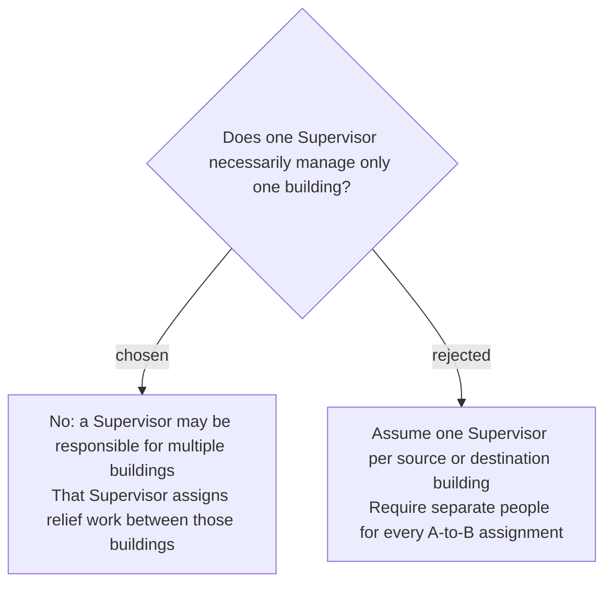

# A Supervisor may schedule multiple assigned buildings

On 2026-11-16 the owner corrected the premise of the cross-building assignment question: a Supervisor may be responsible for multiple buildings, and Supervisor A can therefore assign the relief Cleaner. A source building and a destination building do not necessarily have different Supervisors. The scheduling design must support a Supervisor arranging work within their assigned set of buildings rather than assuming exactly one building per account.

This amends the single-building assumption in [facility-0132](facility-0132-supervisor-scheduling-scoped-to-own-building-and-shift.md) and the scheduling extension of [facility-0048](facility-0048-supervisor-assigned-to-building.md). The assigned-building boundary remains: this does not grant access to every building. The previously accepted own-shift boundary is not changed by this answer. Admin retains all-building/all-shift authority under [facility-0133](facility-0133-admin-manages-schedules-across-buildings-and-shifts.md).

For [facility-0139](facility-0139-relief-cleaners-may-work-across-buildings.md), one Supervisor who is responsible for both buildings may assign the relief Cleaner between them; do not require a destination-Supervisor handoff merely because the building changes. [facility-0141](facility-0141-supervisor-shares-building-scope-for-view-schedule-and-inspection.md) subsequently confirms that the same assigned building set governs work visibility, scheduling and inspection within the Supervisor's shift. [facility-0142](facility-0142-one-regular-supervisor-per-building-and-shift.md) subsequently rules out overlapping regular Supervisor responsibility for a building in the same shift. Coordination where buildings genuinely have different responsible Supervisors and relief shift eligibility remain unresolved.

Read-only verification: `User.BuildingId` stores one Supervisor building, `SupervisorSlot` is a unique computed slot for that building and shift, and `SupervisorScope.WithoutCover` compares a point against a single building ID. Existing account storage and inspection rules therefore cannot be assumed to support the accepted multiple-building scheduling model. No storage shape or inspection-rights change is selected by this decision.

Accepted design only; no application, schema, database or runtime changes have been made.
