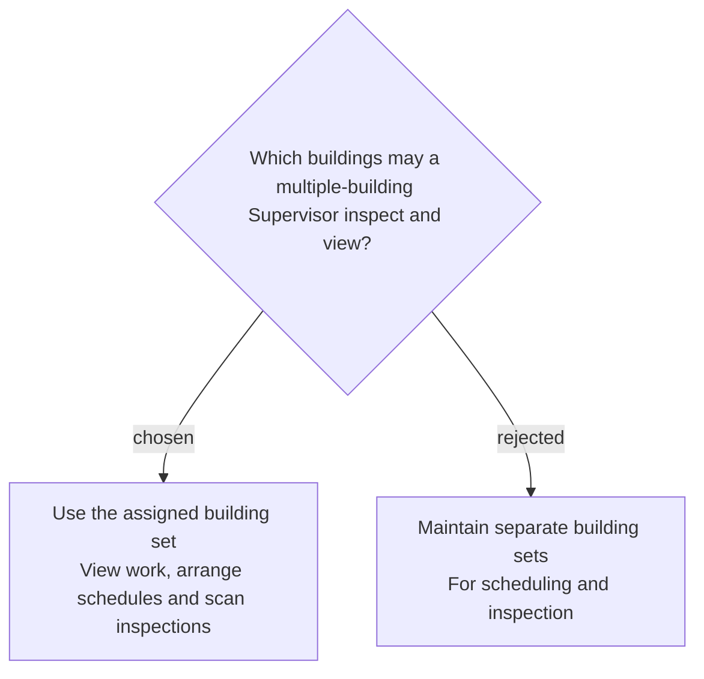

# Supervisor uses the same assigned buildings for viewing, scheduling and inspection

On 2026-11-16 the owner selected A: a Supervisor responsible for buildings A and B may view work, arrange schedules and scan inspections in both buildings within their assigned shift. The same assigned building set governs these activities. This completes the scope clarification left open in [facility-0140](facility-0140-supervisor-may-schedule-multiple-assigned-buildings.md).

This amends the single-building inspection assumption in [facility-0048](facility-0048-supervisor-assigned-to-building.md), not just its scheduling extension. It does not grant access to all buildings or change inspection eligibility, the current-round/latest-submission rules, shift timing, GPS behavior, or existing temporary inspection-cover rules. Admin retains the authority recorded in [facility-0133](facility-0133-admin-manages-schedules-across-buildings-and-shifts.md).

[facility-0142](facility-0142-one-regular-supervisor-per-building-and-shift.md) subsequently confirms one regular responsible Supervisor per building and shift, while allowing one Supervisor to manage multiple buildings. How assigned-building changes take effect and coordination between different Supervisors remain unresolved. The design/spec must review affected account setup, scope checks, work lists, live-update subscriptions, summaries and historical ownership; this decision does not choose the persistence model or claim those paths have been implemented.

Accepted design only; no application, schema, database or runtime changes have been made.
