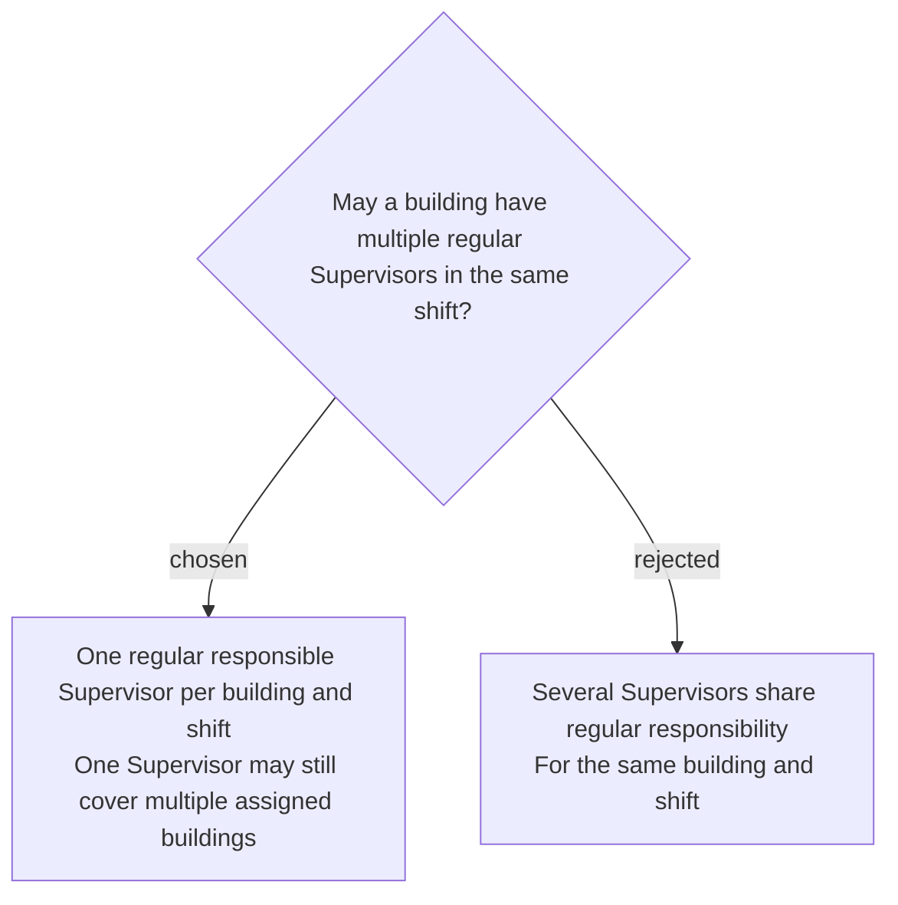

# One regular responsible Supervisor per building and shift

On 2026-11-16 the owner selected A: each building has one regular responsible Supervisor per shift. A Supervisor may be responsible for multiple buildings as accepted in [facility-0140](facility-0140-supervisor-may-schedule-multiple-assigned-buildings.md), but the regular building sets of Supervisors in the same shift do not overlap. For example, if Supervisor A is responsible for buildings 1 and 2 in the day shift, Supervisor B is not also regularly responsible for building 2 in that shift.

The shared viewing, scheduling and inspection scope in [facility-0141](facility-0141-supervisor-shares-building-scope-for-view-schedule-and-inspection.md) follows that responsibility. This preserves a clear regular owner for each building/shift while removing the old one-building-per-Supervisor restriction.

This is a rule about regular assignment uniqueness, not a new requirement to reject creating a building before a Supervisor has been assigned. It does not remove existing temporary inspection-cover behavior or settle who coordinates relief work between different Supervisors. Relief shift affiliation and assignment-change effective dates remain open.

Accepted design only; no application, schema, database or runtime changes have been made.
