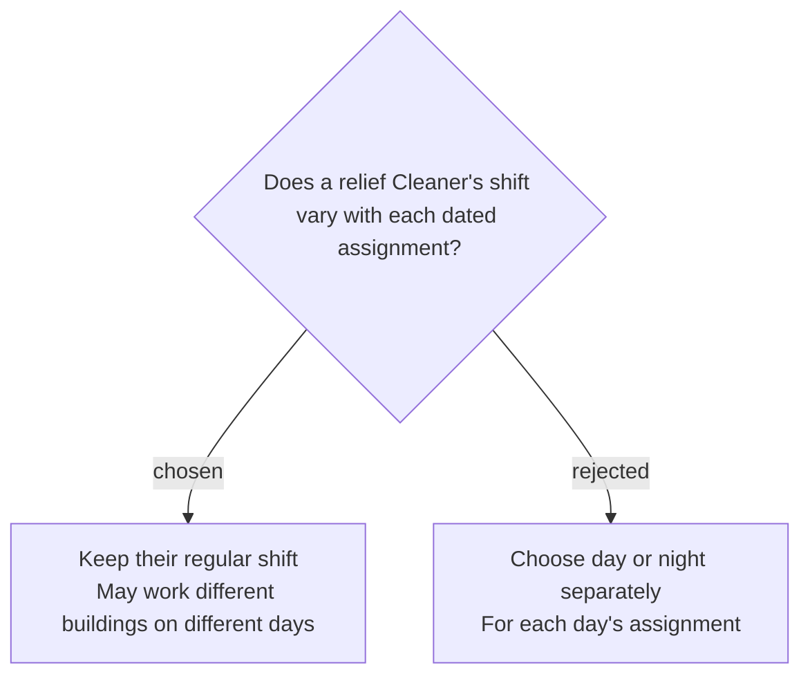

# Relief Cleaners keep a regular shift when moving between buildings

On 2026-11-16 the owner selected A: each relief Cleaner has a regular shift, like a regular Area Cleaner. They may move between buildings on different dates but continue working their regular shift. For example, a day-shift relief Cleaner may work in building A on Monday and building B on Tuesday, both in the day shift.

This resolves relief shift affiliation left open by [facility-0137](facility-0137-dedicated-relief-cleaners-cover-days-off.md) and [facility-0139](facility-0139-relief-cleaners-may-work-across-buildings.md). Cross-building mobility does not mean day-to-day cross-shift assignments. It is consistent with the existing cover endpoint's regular-shift eligibility check, but does not make the current relief candidate or check-in paths sufficient.

The six-workday pattern in [facility-0138](facility-0138-relief-cleaners-receive-six-days-of-assigned-work.md) and Supervisor assigned-building/shift scope in [facility-0140](facility-0140-supervisor-may-schedule-multiple-assigned-buildings.md) and [facility-0141](facility-0141-supervisor-shares-building-scope-for-view-schedule-and-inspection.md) remain. [facility-0144](facility-0144-relief-cleaner-takes-one-area-for-the-whole-shift.md) subsequently confirms one Area for the whole shift on the selected day. How recurring assignments are entered and effective dates for a permanent regular-shift change remain unresolved. No shift hours or OT rules are selected here.

Accepted design only; no application, schema, database or runtime changes have been made.
