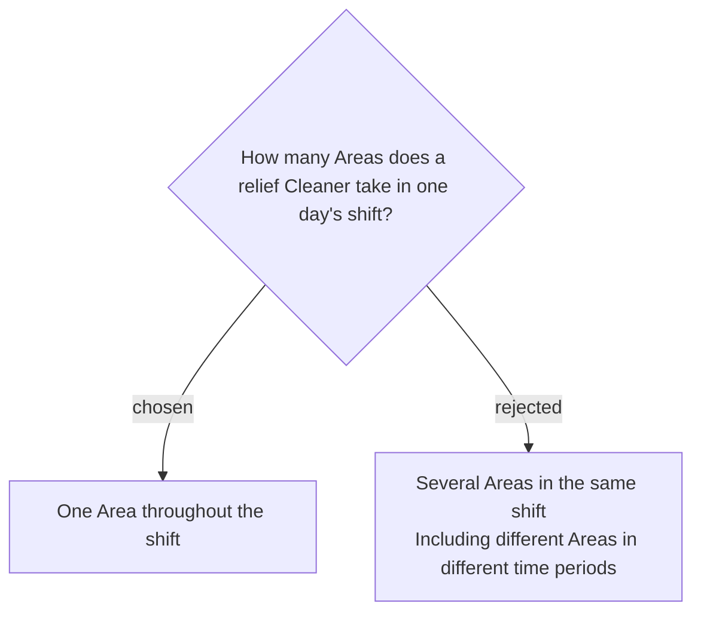

# A relief Cleaner takes one Area for the whole shift

On 2026-11-16 the owner selected A: a relief Cleaner receives one Area for the whole shift on the selected day. The Supervisor does not split that person's shift into Area A in one period and Area B in another or assign multiple Areas in the same shift.

The Area may change on another date or be in another building under [facility-0139](facility-0139-relief-cleaners-may-work-across-buildings.md), while the person's regular shift remains under [facility-0143](facility-0143-relief-cleaners-keep-a-regular-shift.md). The six-workday pattern in [facility-0138](facility-0138-relief-cleaners-receive-six-days-of-assigned-work.md) therefore comprises daily whole-shift Area duties rather than pieces of a shift across several Areas.

This describes the intended relief schedule. It does not select how draft conflicts are handled, authorize rewriting completed work when a schedule is corrected, or change all existing cover-assignment callers globally. [facility-0145](facility-0145-relief-schedules-repeat-weekly-with-dated-overrides.md) subsequently accepts recurring weekly timetables with changes on selected dates. Reassignment after work has started and QR/attendance behavior still need definition. Whether an additional duty may help an already staffed Area remains separate from how many Areas this relief Cleaner takes.

Accepted design only; no application, schema, database or runtime changes have been made.
