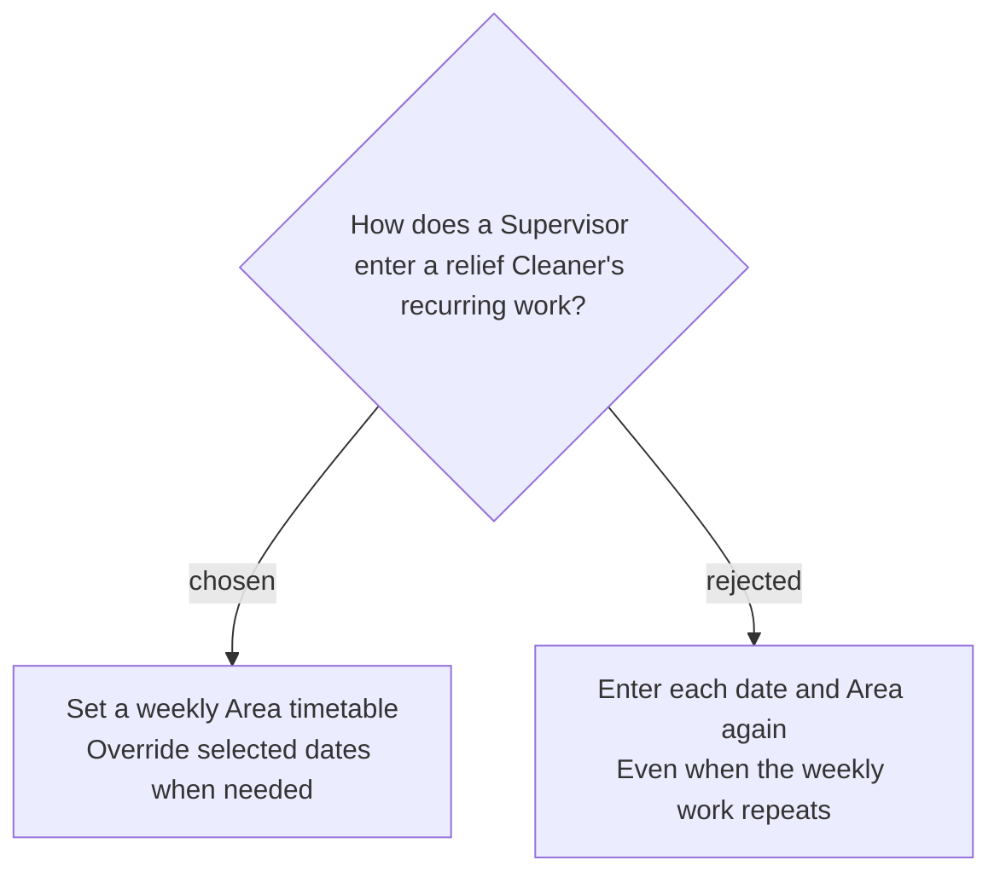

# Relief schedules repeat weekly with changes for selected dates

On 2026-11-16 the owner selected A: a Supervisor may set a relief Cleaner's regular weekly timetable, such as Monday in Area A and Tuesday in Area B, filling the six workdays. The timetable repeats each week; an assignment can change for a selected date without replacing the normal timetable for other dates.

The timetable follows the regular-shift rule in [facility-0143](facility-0143-relief-cleaners-keep-a-regular-shift.md), one-Area-per-whole-shift rule in [facility-0144](facility-0144-relief-cleaner-takes-one-area-for-the-whole-shift.md), and assigned-building scope in [facility-0140](facility-0140-supervisor-may-schedule-multiple-assigned-buildings.md). This accepts dated changes to relief assignments, not a general policy for swapping regular Cleaners' days off or editing already recorded attendance.

This extends the manual repeated-week assignment approach in [facility-0075](facility-0075-covers-assigned-up-to-7-days-ahead.md): the new weekly timetable must not require re-entry every seven days. That ADR's seven-day limit is an existing UI limit for explicit covers, not an existing server validation. This decision does not remove all explicit-date limits or choose infinite materialized assignment rows; the spec must define effective dates, expansion and historical consistency.

How incomplete drafts, conflicts, leave, relief days off and post-start schedule edits behave remains open. The six-day expectation is not automatically a hard save validation. Accepted design only; no application, schema, database or runtime changes have been made.
