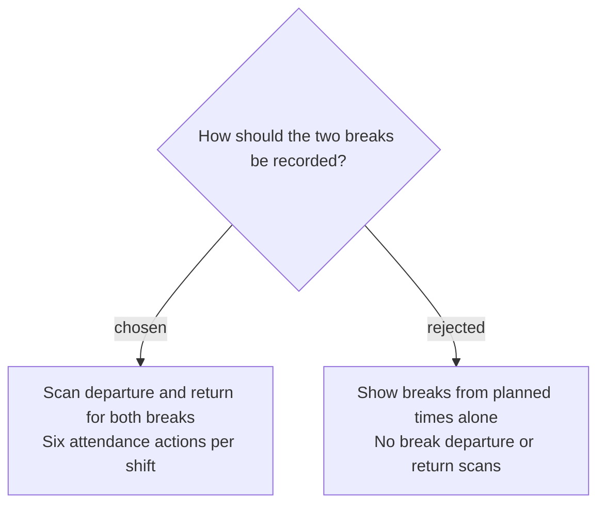
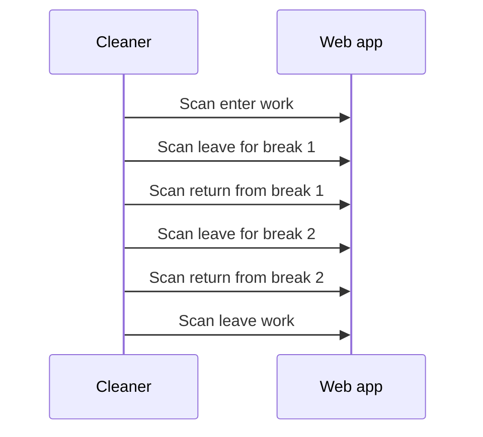

# Two breaks use six scanned attendance actions per shift

On 2026-11-16 the owner selected A: a Cleaner scans both departure and return for each of the two breaks. The normal shift lifecycle is six attendance actions, in order: enter work, leave for break 1, return from break 1, leave for break 2, return from break 2, and leave work. Displayed break activity must be based on recorded actions rather than treating the timetable alone as proof that a person left or returned.

This supersedes the single-break/four-action lifecycle in [facility-0031](facility-0031-four-stage-shift-attendance-lifecycle.md) and its four-action references in [facility-0050](facility-0050-check-in-confirms-area-presence-not-time-attendance.md) for the new design. The existing code still implements four event types with one record of each type per person/shift; no representation for identifying the two break cycles has been chosen here.

## Normal attendance sequence

This is the normal sequence, not a decision to reject every missing or early/late action. Planned times versus allowed scan times, omitted events, early departure, corrections, relief QR entry, submission during breaks, and treatment of older four-action history still need definition. The spec must address these callers and histories before tightening shared attendance validation. This does not introduce payroll or OT calculations.

Accepted design only; no application, schema, database or runtime changes have been made.

**Legacy-history clarification:** [facility-0164](facility-0164-preserve-legacy-four-action-attendance-history.md) confirms old four-action shifts retain their original history without fabricated or falsely missing second-break events. New six-action expectations begin with shifts using the new flow; exact cutover and caller compatibility still need definition.
