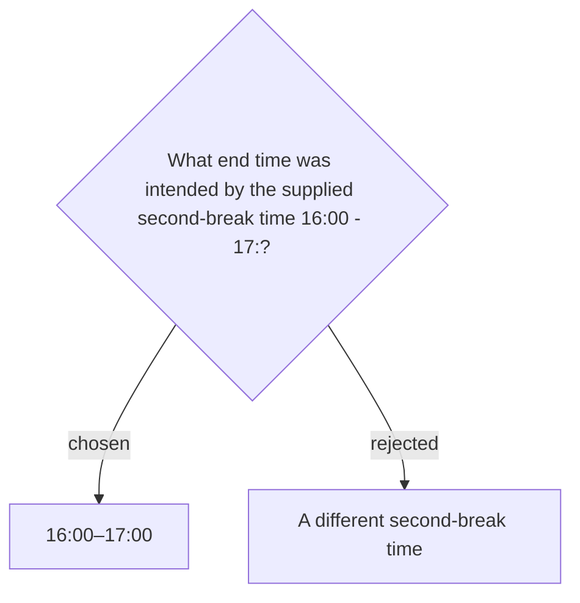

# Day-shift second break is 16:00–17:00

On 2026-11-16 the owner confirmed that the day shift's second break is 16:00–17:00. This completes the previously truncated end time in the Supervisor's field requirements. The original field input says this second break is taken together by everyone, unlike the first break's two staggered groups.

This identifies the planned time, not a rule that scans must occur exactly at the scheduled start/end. Both departure and return still require actual scans under [facility-0146](facility-0146-two-breaks-use-six-scanned-attendance-actions.md). [facility-0148](facility-0148-first-break-staggered-second-break-shared-before-ot.md) subsequently confirms break 2 is the pre-OT break shared simultaneously by the whole shift. Whether shift hours vary, allowed scan timing and exception behavior remain open.

Accepted design only; no application, schema, database or runtime changes have been made.
