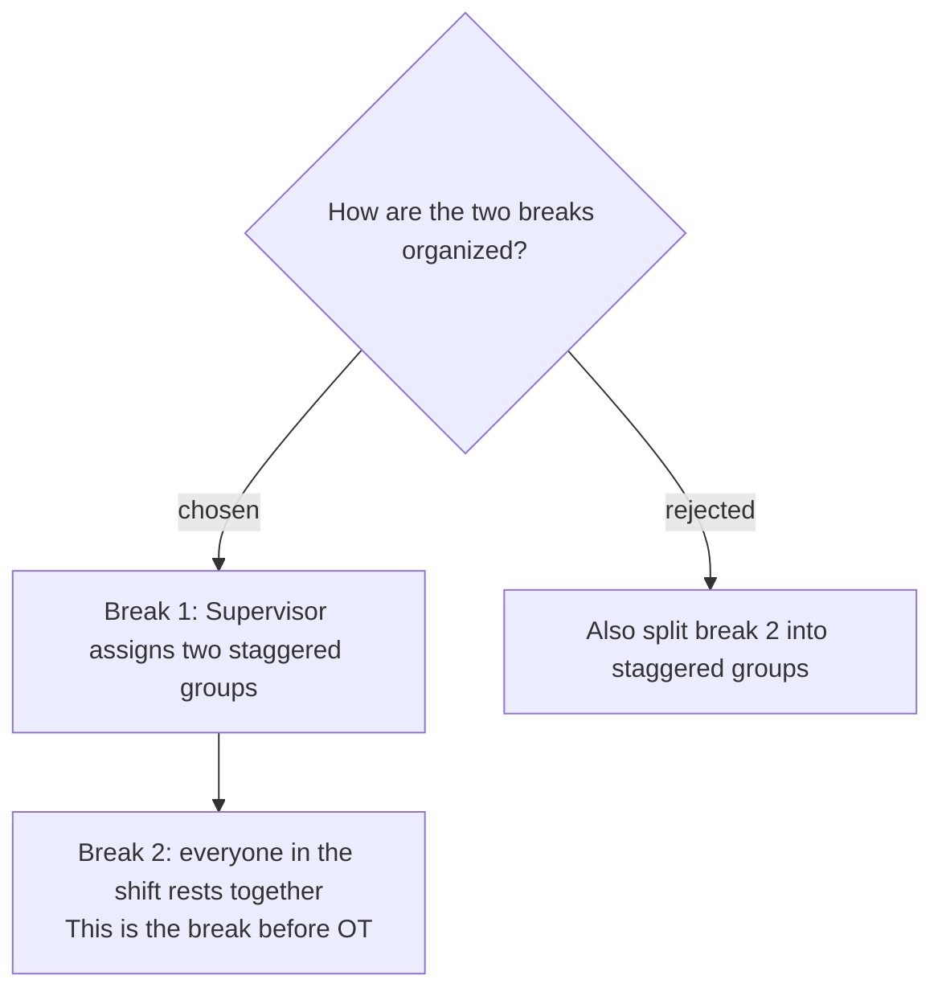

# First break is staggered; second break is shared by the whole shift before OT

On 2026-11-16 the owner clarified that “พักก่อนทำ OT” refers to break 2. Break 1 is staggered in two Supervisor-assigned groups, while break 2 is taken simultaneously by everyone in the shift. The night shift follows the same arrangement.

| Shift | Break 1, group 1 | Break 1, group 2 | Break 2, everyone together, before OT |
|---|---|---|---|
| Day | 10:00–11:00 | 11:00–12:00 | 16:00–17:00 |
| Night | 22:00–23:00 | 23:00–24:00 | 04:00–05:00 |

The owner's example of 50 day-shift Cleaners split 25/25 for break 1 illustrates staggering; all 50 then rest together at 16:00–17:00. It does not establish an actual workforce count, a fixed group capacity, or an enforced equal-size grouping algorithm.

Both departures and returns remain scanned under [facility-0146](facility-0146-two-breaks-use-six-scanned-attendance-actions.md). The day-shift break-2 end time was confirmed in [facility-0147](facility-0147-day-shift-second-break-is-1600-to-1700.md). Planned simultaneous breaks do not establish that the system auto-records attendance or rejects scans a few minutes outside the plan.

[facility-0149](facility-0149-break-scans-record-actual-times-against-plan.md) subsequently confirms that break scans record actual times and are not rejected solely for falling outside the planned break window. Other eligibility/order/shift checks, break-group recurrence and dated changes, how a relief Cleaner gets a break group, and any cases where someone does not work OT still need definition. This records the break's relationship to OT, not payroll calculation, OT eligibility, or newly approved shift start/end hours. Accepted design only; no application, schema, database or runtime changes have been made.
