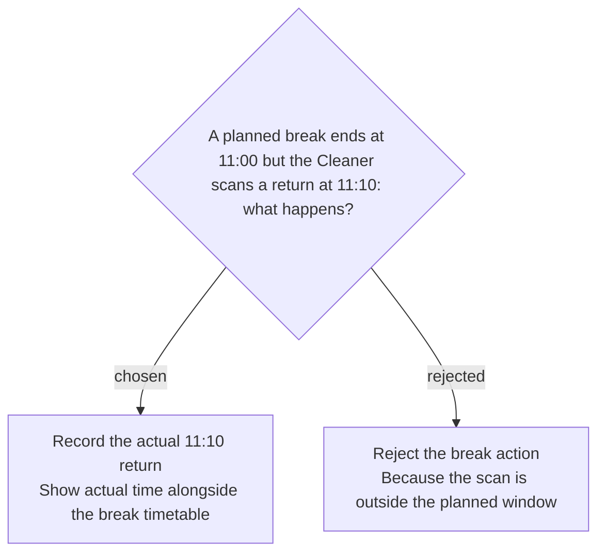

# Record actual break scan times and show them against the plan

On 2026-11-16 the owner selected A: accept actual break scan times and display them against planned break times. In the example, a Cleaner scheduled to rest at 10:00–11:00 who returns at 11:10 has an actual 11:10 return recorded. Deviation from a planned break window alone must not reject a break scan.

The staggered first break and shared second break in [facility-0148](facility-0148-first-break-staggered-second-break-shared-before-ot.md) remain the timetable, not fabricated attendance. Both break departures and returns still require scans under [facility-0146](facility-0146-two-breaks-use-six-scanned-attendance-actions.md). Do not round or replace recorded times with the planned times.

This relaxes only the proposed break-window restriction; normal authentication, assigned-Area/QR eligibility, GPS input, event ordering and shift receiving rules still need to apply according to the final design. It does not approve arbitrary out-of-shift events, missing-event policies, payroll or a new lateness alert. The existing no-payroll scope in [facility-0050](facility-0050-check-in-confirms-area-presence-not-time-attendance.md) remains.

Shift hours and no-OT cases, missed scans, corrections, break-group recurrence and relief grouping still need definition. Accepted design only; no application, schema, database or runtime changes have been made.
