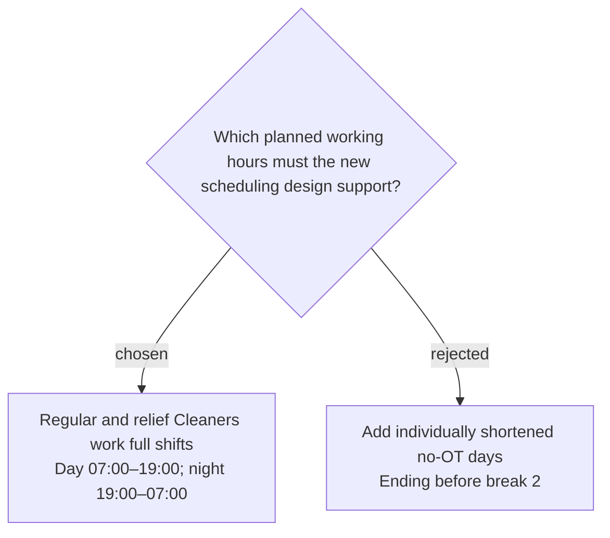

# Regular and relief Cleaners keep the full day and night shifts

On 2026-11-16 the owner selected A: all regular and relief Cleaners work the existing full day shift, 07:00–19:00, or night shift, 19:00–07:00, on their working days. The new requirement does not add individually shortened planned shifts for days without OT.

This confirms the shift-hour baseline in [facility-0040](facility-0040-area-is-the-unit-of-assignment.md), alongside the relief regular-shift decision in [facility-0143](facility-0143-relief-cleaners-keep-a-regular-shift.md). The staggered first break and shared pre-OT second break follow [facility-0148](facility-0148-first-break-staggered-second-break-shared-before-ot.md).

These are planned shift hours, not a new rule that an actual Shift-Out must occur exactly at 19:00 or 07:00. This does not add payroll, lateness or early-leave calculations, change the existing attendance receiving-window policy, or decide how missing scans and exceptional early departures are recorded. Actual break times still follow [facility-0149](facility-0149-break-scans-record-actual-times-against-plan.md).

Accepted design only; no application, schema, database or runtime changes have been made.
