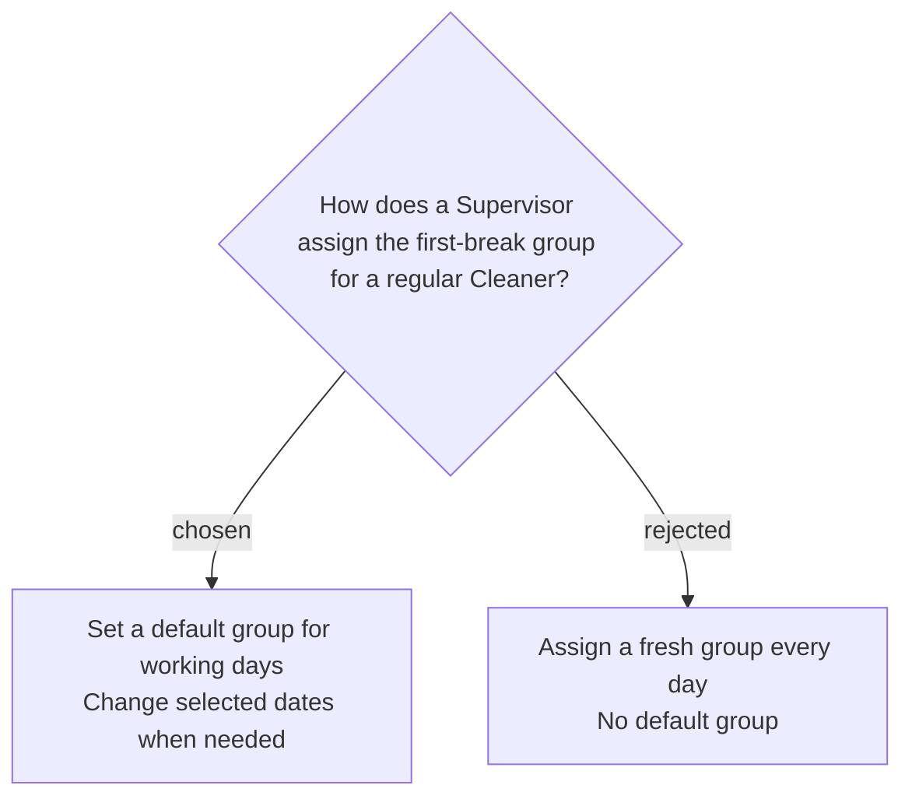

# Regular Cleaners have a default first-break group with dated changes

On 2026-11-16 the owner selected A: a regular Area Cleaner has a default first-break group, such as 10:00–11:00 on their working days, and the Supervisor may change that group for a selected date. The Supervisor need not recreate unchanged group assignments each day. A selected-date change does not replace the default for other dates.

This follows the two-group first break and shared second break in [facility-0148](facility-0148-first-break-staggered-second-break-shared-before-ot.md). It applies to regular Area Cleaners; [facility-0152](facility-0152-relief-break-group-defaults-to-replaced-cleaner.md) subsequently confirms relief staff initially use the replaced person's group with a Supervisor-controlled selected-date override. The shared second break is not split into these groups.

The actual-time recording policy in [facility-0149](facility-0149-break-scans-record-actual-times-against-plan.md) remains. This does not add equal group-size validation, choose how group changes after a break starts affect history, or settle effective-date/storage details. Accepted design only; no application, schema, database or runtime changes have been made.

**Subsequent clarification:** [0187](facility-0187-regular-timetable-has-a-selected-future-start-date.md) accepts selecting a future start date for a regular timetable change. [0189](facility-0189-regular-break-changes-preserve-dated-break-overrides.md) preserves a previously explicit dated first-break override when a new regular break group starts; incompatible off/leave/Area cases remain unresolved.
