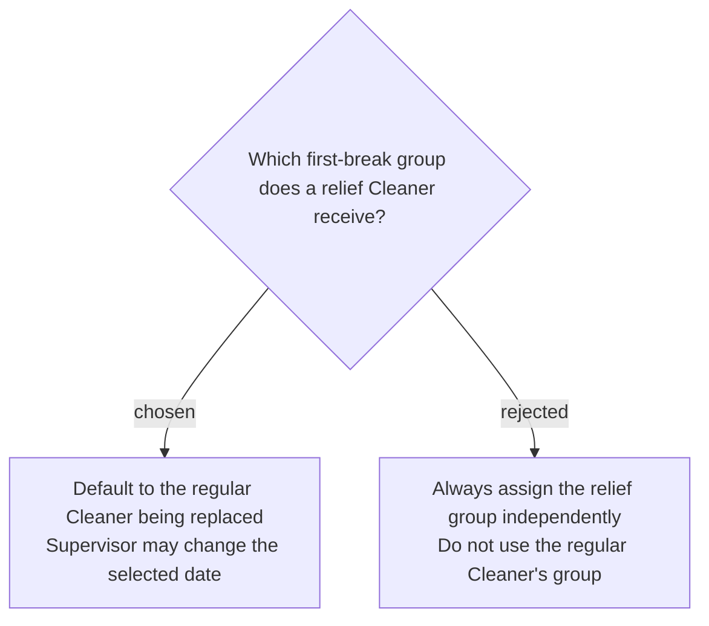

# Relief first-break group defaults to the replaced Cleaner with a dated override

On 2026-11-16 the owner selected A: when a relief Cleaner takes a regular Cleaner's Area for a date, the web app initially uses the replaced person's first-break group. The Supervisor may change that group for the selected date. For example, if the regular Cleaner rests at 10:00–11:00, the relief Cleaner initially receives 10:00–11:00 as well.

This extends the default-and-dated-change behavior in [facility-0151](facility-0151-regular-cleaners-have-default-break-groups-with-dated-changes.md) to relief assignments. It preserves the intended staggered break arrangement without requiring the Supervisor to select the same group manually for every recurring replacement. Break 2 remains simultaneous for the whole shift under [facility-0148](facility-0148-first-break-staggered-second-break-shared-before-ot.md).

Actual break scans are still recorded independently under [facility-0149](facility-0149-break-scans-record-actual-times-against-plan.md). This does not choose when the inherited group is captured, whether later edits to the regular person's plan affect future relief dates, or a fallback where no regular person/group exists. Those consistency and missing-setup cases must be defined before spec approval; do not invent a group's value or apply new required inputs globally to unrelated callers.

Accepted design only; no application, schema, database or runtime changes have been made.
