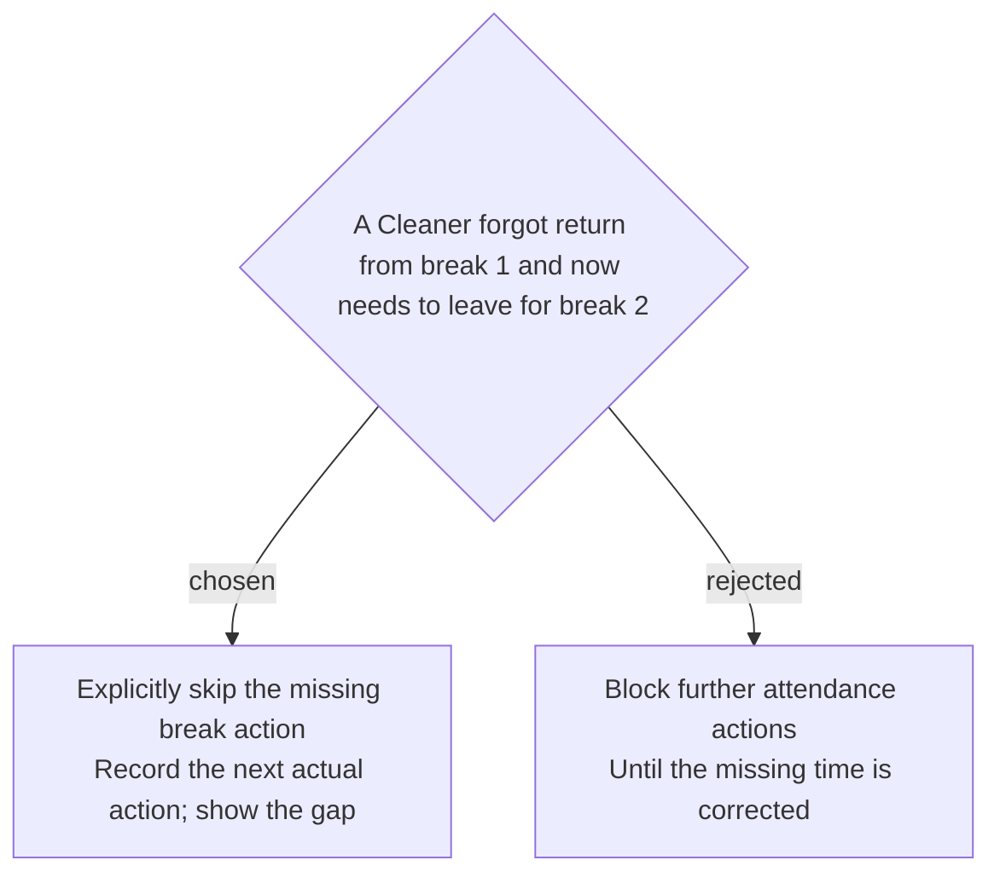

# A missing break scan may be explicitly skipped without inventing a time

On 2026-11-16 the owner selected A: a Cleaner may explicitly skip a forgotten intermediate break action and record the next real action. In the discussed example, they forgot to scan their return from break 1 and may then scan departure for break 2 at 16:00. The return-from-break-1 time remains empty and visibly missing; the app must not insert the planned return time or a guessed actual time.

This makes the normal six-action sequence in [facility-0146](facility-0146-two-breaks-use-six-scanned-attendance-actions.md) tolerant of missing break scans through an explicit choice, rather than requiring fabricated entries to continue. The timetable-versus-actual distinction in [facility-0149](facility-0149-break-scans-record-actual-times-against-plan.md) remains intact. This extends the missing-time principle of [facility-0051](facility-0051-admin-corrections-and-audit-log.md).

The decision concerns missing intermediate break actions after entering work. It does not remove the requirement to check in before submitting work, permit arbitrary out-of-order or duplicate records, or silently infer which action the Cleaner intended from the clock. The UI, missing-time indicators and validation must distinguish a deliberate skip from a recorded time.

Who may add or correct missing times is the next question. How late corrections, older four-action histories and callers of shared attendance checks are handled must be specified before implementation. Accepted design only; no application, schema, database or runtime changes have been made.
