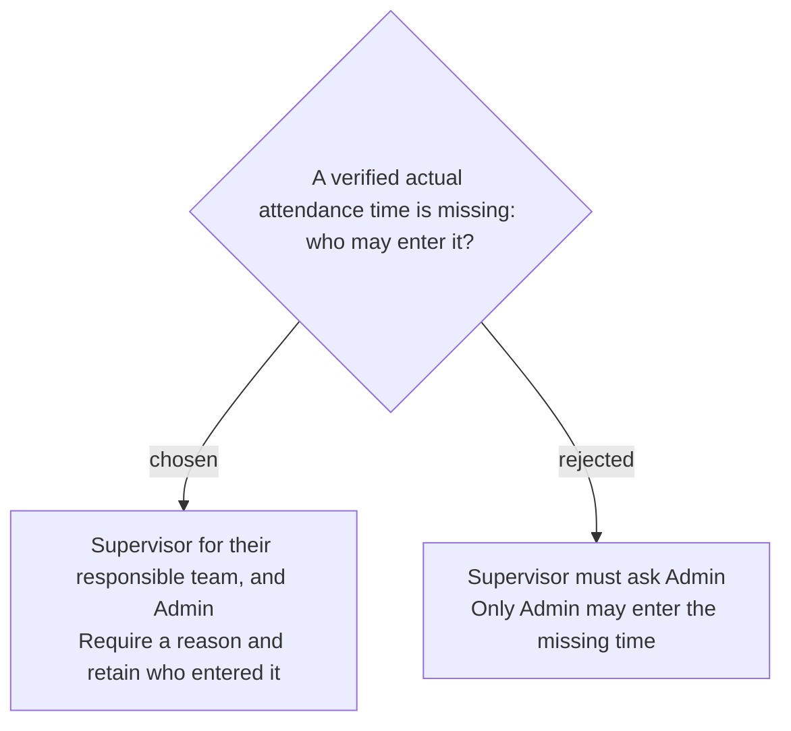

# Supervisor may fill missing team attendance with a reason and history

On 2026-11-16, after a concrete explanation of filling an empty return-from-break field, the owner selected A: a Supervisor may fill a missing attendance time for their team after the actual time is verified, and Admin may also fill it. A reason is required and the history must identify who entered the time. For example, a verified 11:00 return that was not scanned may be entered later as 11:00 with the reason.

Supervisor scope follows their assigned buildings and shift under [facility-0140](facility-0140-supervisor-may-schedule-multiple-assigned-buildings.md) and [facility-0141](facility-0141-supervisor-shares-building-scope-for-view-schedule-and-inspection.md). Admin retains all-building/all-shift authority. This amends the Admin-only missing-time entry rule in [facility-0051](facility-0051-admin-corrections-and-audit-log.md), while keeping the reason and audit-history requirements.

The clarified answer concerns filling missing actual times, not general authority for a Supervisor to overwrite an existing scan. Existing Admin correction rights remain; wider Supervisor editing rights have not been accepted. Cleaners are not granted self-service historical time entry. No time is generated automatically from the timetable, as established in [facility-0153](facility-0153-missing-break-scan-can-be-skipped-without-fabricating-time.md).

The spec must define late-entry validation, provenance labels and how responsibility is checked for historical assignments, including relief staff. The existing `/api/admin/attendance` group is Admin-only; it has not been opened to Supervisors. Accepted design only; no application, schema, database or runtime changes have been made.
