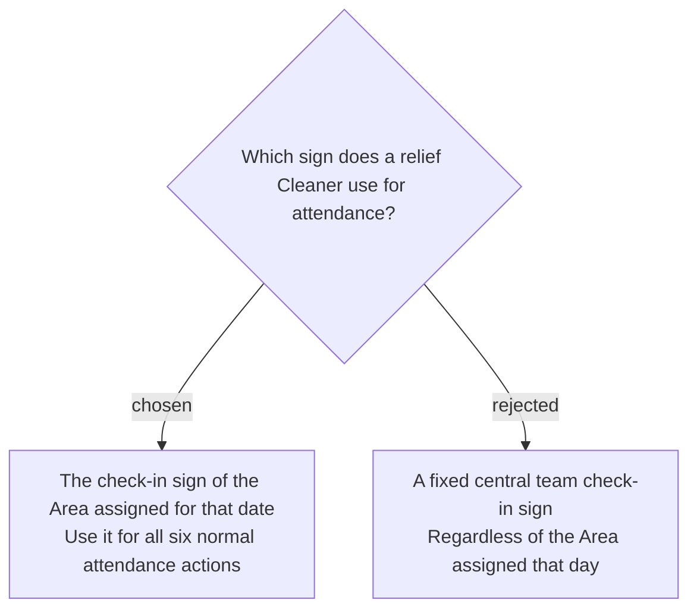

# Relief attendance uses the sign of the Area assigned for that date

On 2026-11-16 the owner selected A: a relief Cleaner records attendance at the Check-In Sign of the Area assigned for that date. If they work Area A on Monday and Area B on Tuesday, they use A's sign on Monday and B's on Tuesday. This applies to entering work, both break departures/returns, and leaving work.

This complements the one-Area-per-whole-shift rule in [facility-0144](facility-0144-relief-cleaner-takes-one-area-for-the-whole-shift.md) and six-action lifecycle in [facility-0146](facility-0146-two-breaks-use-six-scanned-attendance-actions.md). It replaces the old assumption in [facility-0041](facility-0041-scan-only-own-area-with-cover-assignment.md) that a covering Cleaner always has a regular Area and checks in there, specifically for the accepted relief workflow. Do not assign a fake permanent Area to a relief account to make this work.

The dated assignment supplies the permitted attendance Area; another Area's sign is not made valid merely because the person is relief staff. This does not add a central team sign, remove GPS checks, or treat assignment alone as a recorded entry. Recurring timetables and dated changes follow [facility-0145](facility-0145-relief-schedules-repeat-weekly-with-dated-overrides.md).

The spec must define resolution within the existing overnight shift-date and receiving-window rules, behavior when no assignment exists, changes after attendance/work has started, and compatible behavior for regular Cleaners and historical records. Availability/conflict and overview-entry counting rules still need final design review. Accepted design only; no application, schema, database or runtime changes have been made.
