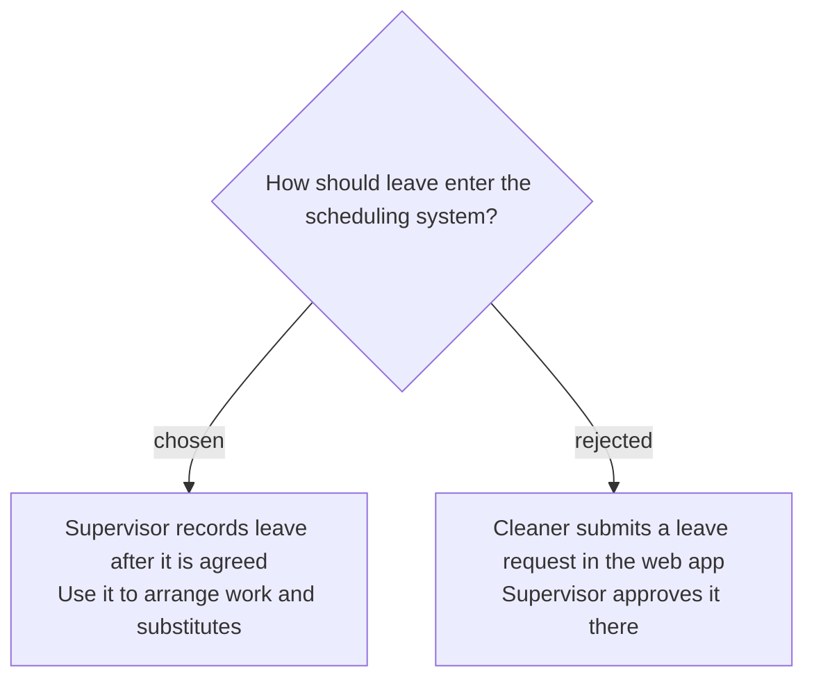

# Supervisor records agreed leave without an in-app request workflow

On 2026-11-16 the owner selected A: a Supervisor records a Cleaner's leave after it has already been agreed. This work does not add Cleaner leave-request forms, pending requests or an in-app approval process. Do not invent the external communication channel or approval procedure.

Recorded leave supports scheduling and replacement staffing, within Supervisor assigned-building/shift authority under [facility-0141](facility-0141-supervisor-shares-building-scope-for-view-schedule-and-inspection.md). Admin retains the scheduling authority in [facility-0133](facility-0133-admin-manages-schedules-across-buildings-and-shifts.md). This extends the personal schedule capture beyond recurring weekly days off in [facility-0135](facility-0135-cleaners-have-recurring-weekly-days-off.md); it does not introduce company payroll or OT calculation.

[facility-0157](facility-0157-recorded-leave-includes-partial-shifts.md) subsequently confirms both full-shift and partial-shift leave, including half-day and hourly absences. Leave types, required fields, cancellation/effective dates, lack of an available substitute, and treatment when attendance or work already exists remain to be specified. A leave entry is not a recorded attendance time or proof that replacement work has occurred.

Accepted design only; no application, schema, database or runtime changes have been made.
