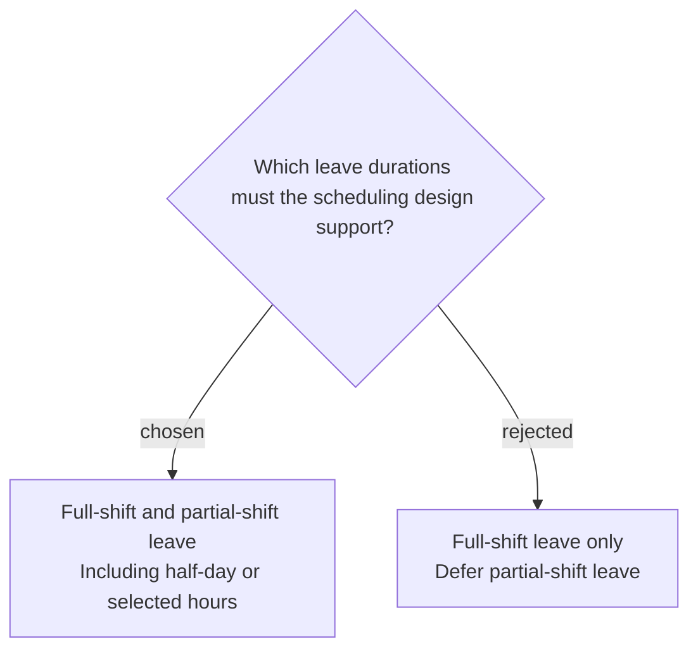

# Recorded leave includes half-day and hourly absences

On 2026-11-16 the owner selected B in the interview: this release must support half-day or hourly leave as well as full-shift leave. The Supervisor records the already-agreed leave under [facility-0156](facility-0156-supervisor-records-agreed-leave-without-request-workflow.md). Partial leave cannot be represented as absence for the entire shift without losing the distinction between working and absent periods.

The normal day/night shift hours in [facility-0150](facility-0150-cleaners-keep-full-day-and-night-shift-hours.md) remain the baseline; an agreed leave interval is an exception within that shift, not a new permanently shortened no-OT shift or a payroll rule.

How replacement work covers that interval remains unresolved. On 2026-11-16 the owner explicitly deferred this question because they do not know the field practice and will ask the Supervisor later; no whole-shift or split-period option was selected. The one-Area-for-the-whole-shift relief decision in [facility-0144](facility-0144-relief-cleaner-takes-one-area-for-the-whole-shift.md) is not silently revoked by accepting partial leave. Whether leave adds actual departure/return scans beyond the normal break lifecycle, how overnight intervals are entered, overlap rules, cancellation and post-start corrections remain to be designed.

This does not add Cleaner self-service requests or an approval workflow. Accepted design only; no application, schema, database or runtime changes have been made.

**Field topic 2 answer (2026-11-17):** [0195](facility-0195-partial-shift-departures-have-no-replacement-but-essential-task-help.md) records no replacement duty for the remainder of the reported half-day/OT departure cases, with limited help at essential points. This supersedes the unanswered replacement assumption for those cases only; leave-then-return patterns, exact OT meaning and attendance scans are not answered by it.

**Hourly-errand scope narrowed (2026-11-17):** [0196](facility-0196-no-hourly-errand-leave-and-return-workflow.md) records that hourly leave to run errands during the workday does not occur. Do not build a leave-and-return scan flow for that hypothetical; full-shift/half-day leave remain required, and actual early-departure attendance still needs definition.

**Final half-day departure resolved (2026-11-17):** [0200](facility-0200-half-day-final-departure-records-actual-shift-out.md) accepts existing ShiftOut at actual departure, with separately recorded leave and no further submission that slot. [0201](facility-0201-leave-after-final-departure-makes-later-break-actions-inapplicable.md) marks later breaks covered by the recorded leave as inapplicable while preserving genuinely missing pre-departure events. These supersede the early-departure-attendance pending status above, not other leave/cancellation/transfer boundaries.
