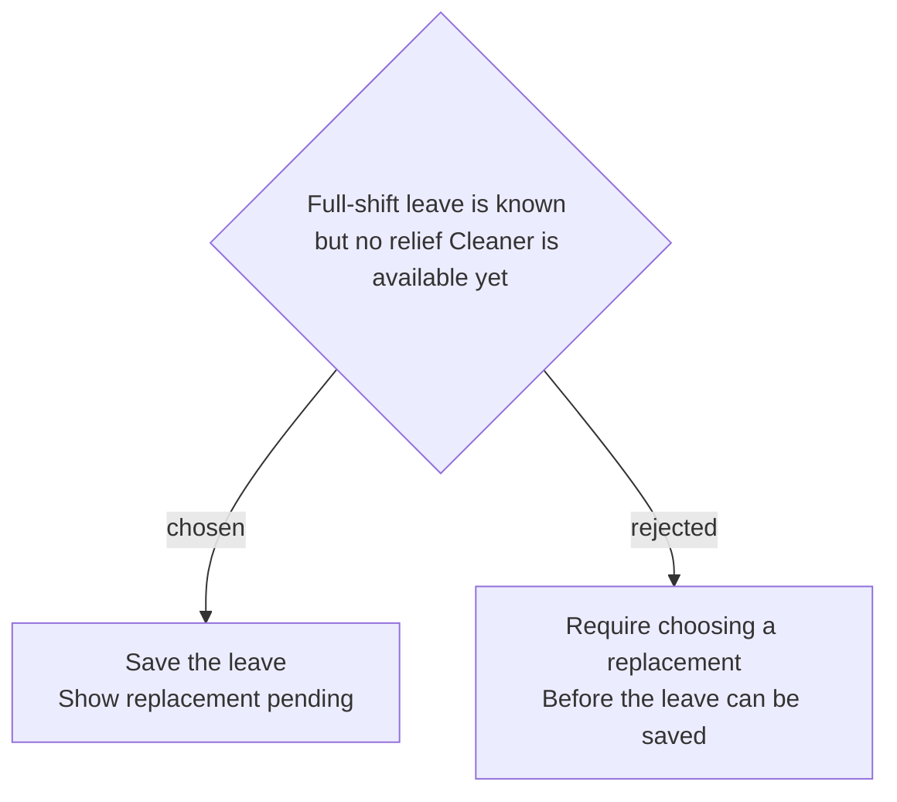

# Full-shift leave may be saved while replacement is still pending

On 2026-11-16 the owner selected A: the Supervisor may save already-agreed full-shift leave even when no relief Cleaner is available yet. The web app shows “รอจัดคนทำแทน” so the unresolved staffing work remains visible. Recording the known absence is not conditional on completing the replacement assignment.

This follows the leave-recording workflow in [facility-0156](facility-0156-supervisor-records-agreed-leave-without-request-workflow.md). All usual Area rounds remain required under [facility-0136](facility-0136-regular-day-off-keeps-all-area-cleaning-rounds.md); saving leave does not close the Area, complete work or count a replacement as assigned. “Replacement pending” describes staffing plans, not proof that nobody is physically present at the current moment.

This question deliberately concerns full-shift leave and is independent of the partial-leave replacement arrangement in [facility-0157](facility-0157-recorded-leave-includes-partial-shifts.md), which the owner will confirm with the Supervisor later. Do not infer a partial-shift relief model from this answer or make a substitute globally required for unrelated setup or attendance operations.

Availability rules, candidate scope, conflict handling and how the pending item is surfaced in the UI remain to be designed. Accepted design only; no application, schema, database or runtime changes have been made.
