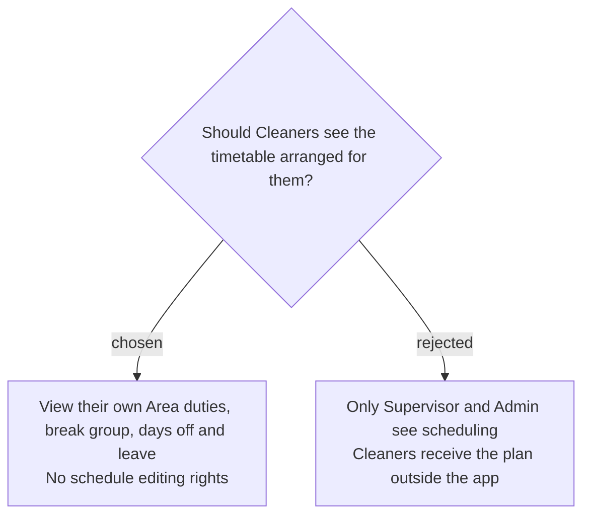

# Cleaners may view only their own schedule, read-only

On 2026-11-16 the owner selected A: Cleaners may view their own schedule on the mobile web, including assigned Areas, break group, regular days off and recorded leave. They cannot edit their schedule. The view should reflect what the responsible Supervisor or Admin has arranged.

This applies to regular and relief Cleaners, including the recurring relief timetable and selected-date changes in [facility-0145](facility-0145-relief-schedules-repeat-weekly-with-dated-overrides.md), break defaults/changes in [facility-0151](facility-0151-regular-cleaners-have-default-break-groups-with-dated-changes.md) and [facility-0152](facility-0152-relief-break-group-defaults-to-replaced-cleaner.md), and recorded leave under [facility-0156](facility-0156-supervisor-records-agreed-leave-without-request-workflow.md).

Read-only scheduling does not remove existing attendance/submission actions, expose other Cleaners' schedules, or add leave requests, self-service schedule changes, QR tokens, exports or notifications. [facility-0160](facility-0160-scheduling-mockup-layout-accepted.md) subsequently accepts the first mockup layout; final application navigation placement and date range remain unconfirmed. The server must scope personal reads to the authenticated Cleaner rather than relying on a client-side filter.

The two outstanding field questions—partial-leave replacement and shared versus team-owned relief staff—remain unresolved; this independent visibility decision does not choose either answer. Accepted design only; no application, schema, database or runtime changes have been made.

Amendment 2026-11-17: [0176](facility-0176-cleaner-schedule-entry-precedes-work-list.md) resolves the personal schedule entry placement and return control; [0179](facility-0179-schedule-viewing-does-not-require-qr-or-gps.md) confirms no QR/GPS prerequisite for authorized schedule reading. The earlier navigation-pending note is superseded; date defaults/range remain unconfirmed. The two originally deferred field questions are now part of the authoritative five-question packet; all five still await answers.
