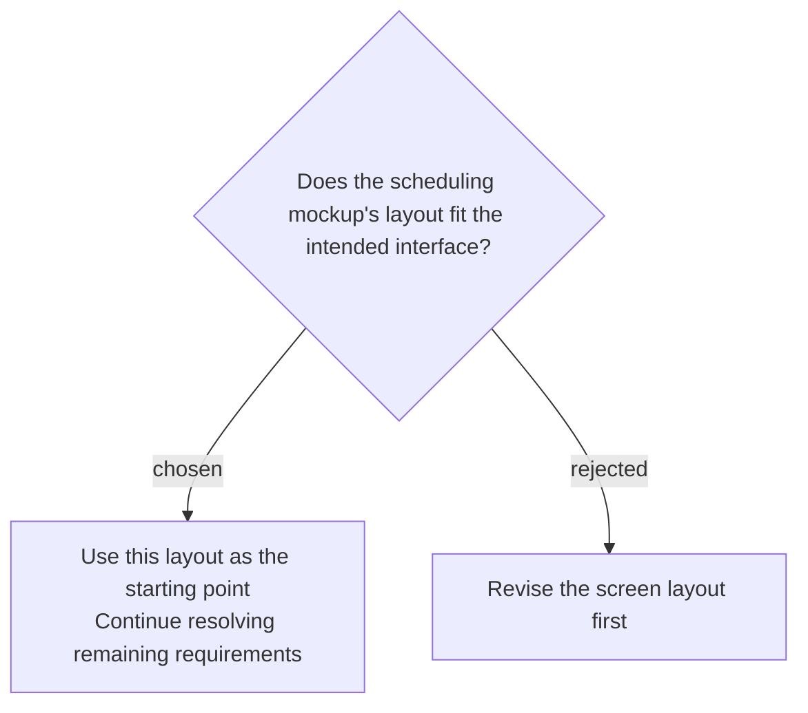

# Scheduling mockup layout accepted as the basis for continued design

On 2026-11-16 the owner selected A: the proposed Supervisor scheduling and personal regular/relief Cleaner views are suitable as the starting layout, and discussion of remaining details should continue. This records layout acceptance, not the final design recap, written spec approval or permission to implement.

The reviewed inline source is `/Users/macbookair/.codex/visualizations/2026/11/16/01a1e35a-cb6e-7920-87dc-50ada17b12f4/facility-scheduling.html`. Reuse this exact source for revisions. The accepted presentation includes a Supervisor weekly timetable with responsive selected-day rows, selected-date break changes, visible full-shift leave/replacement-pending status, and personal read-only regular/relief timetable views under [facility-0159](facility-0159-cleaners-can-view-their-own-schedule-read-only.md).

The partial-leave replacement and shared/team-owned relief-pool questions remain awaiting Supervisor confirmation. Prototype limitations are not product scope cuts: its weekly baseline is shown read-only, candidate selection is not simulated, and full Admin and night-shift variants are not separately previewed. Existing accepted requirements for those behaviors remain. Preview role switches, sample dates/headcounts, optional density controls, specific date-range limits and final application navigation have not become requirements merely through layout acceptance.

Other operational rules still need discussion before the mandatory decision recap and written spec. No application, schema, database or runtime changes, commit or publication are authorized by this acceptance.

Amendment 2026-11-17: the owner accepted the navigation revision in the same source, SHA-256 `f574d3ae19b2c4e055193f07d0df2d0f077dd13f38850754edcb25be5e819bdb`. Entry placement is now resolved separately for [Cleaners (0176)](facility-0176-cleaner-schedule-entry-precedes-work-list.md), [Supervisors (0177)](facility-0177-supervisor-schedule-entry-precedes-building-list.md) and [Admin (0178)](facility-0178-admin-schedule-menu-follows-attendance.md), with [authorized reading independent of QR/GPS (0179)](facility-0179-schedule-viewing-does-not-require-qr-or-gps.md). The new Admin shell is a navigation preview, not a complete Admin scheduling workflow. Default dates/ranges and sample preview controls remain unaccepted; no implementation approval follows.

Further amendment 2026-11-17: [0187](facility-0187-regular-timetable-has-a-selected-future-start-date.md) accepts a selected future start date for regular-Cleaner timetable changes. [0188](facility-0188-regular-timetable-editor-reviews-changes-before-save.md) accepts the regular-Cleaner editor layout and sequence: select person, edit regular values/start date, review before saving. The reviewed same-source revision has SHA-256 `d0b0660cc3d55beb1c3acd286caf4fa046c5709a0e08afc84035e921773f68b7`. Its demonstration limits and unresolved exception policies are not accepted through this layout choice; relief baseline editing remains incomplete.
