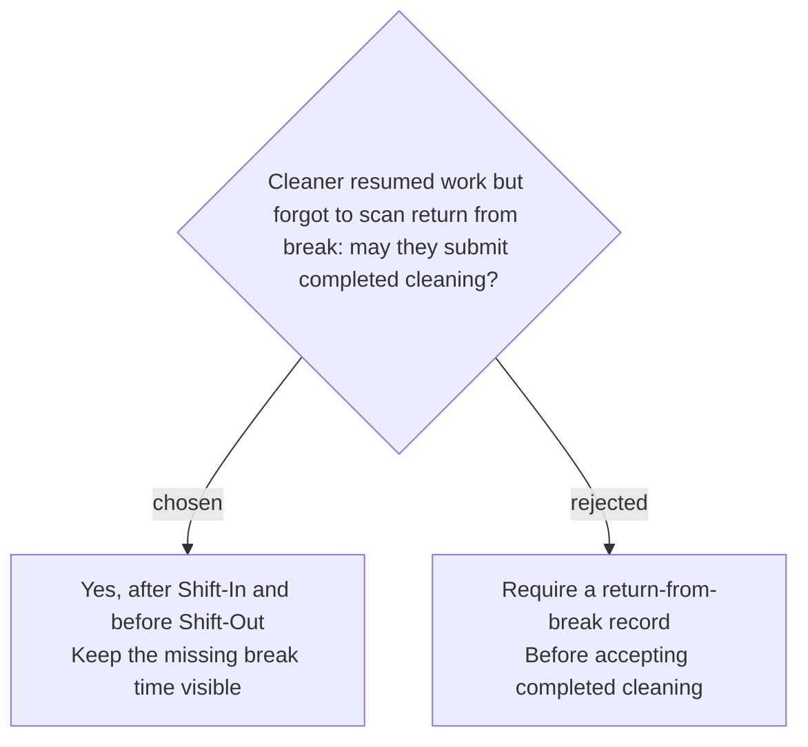

# A missing return-from-break scan does not block work submission

On 2026-11-16 the owner selected A: completed cleaning may still be submitted when a return-from-break scan is missing, provided the Cleaner has entered work and has not recorded leaving work. The missing return time remains available for checking and later verified entry; submitting cleaning does not fill that time automatically.

This preserves the existing `AttendanceRules.IsOnDuty` behavior for the new two-break lifecycle: Shift-In is required and Shift-Out closes submission eligibility; an open or incomplete break sequence alone does not block it. It complements explicit break-action skipping in [facility-0153](facility-0153-missing-break-scan-can-be-skipped-without-fabricating-time.md) and verified missing-time entry in [facility-0154](facility-0154-supervisor-may-fill-missing-team-attendance-with-reason.md). Both break cycles follow this principle.

This does not waive assigned-Area/point permissions, an active valid shift/window, QR/GPS input, or the other submission rules. It does not automatically change the attendance state to working, fabricate a break return, decide behavior during recorded leave, or shift the Service Point's cleaning rounds. Those distinctions must remain explicit in the final design.

Accepted design only; no application, schema, database or runtime changes have been made. Read-only verification reconfirmed the existing attendance rule; no application test suite was rerun for this documentation decision.
