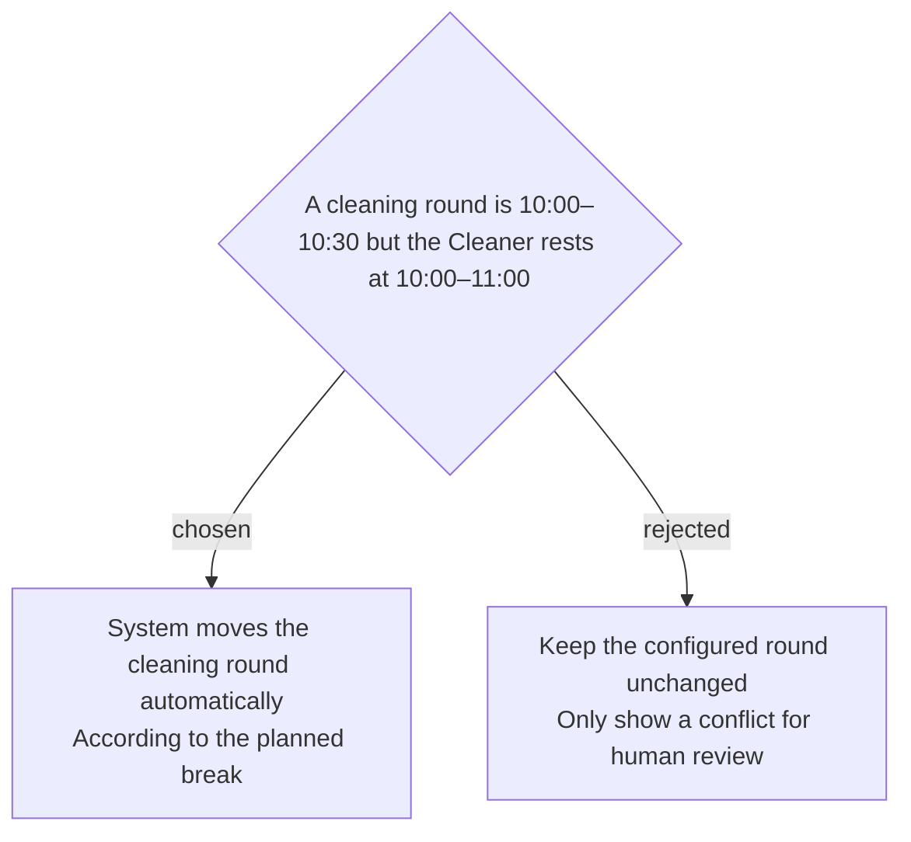

# Cleaning rounds move automatically when they conflict with planned breaks

**Status: superseded by [facility-0163](facility-0163-keep-configured-rounds-without-automatic-break-rescheduling.md).** The owner clarified that actual work timetables already avoid breaks, then explicitly selected keeping configured rounds and excluding automatic rescheduling. The original hypothetical selection below is historical, not a current implementation requirement. No per-date or permanent movement scope was accepted.

On 2026-11-16 the owner selected B in the interview: the system must automatically move a cleaning round that conflicts with the Cleaner's planned break, rather than only keeping the round unchanged and asking the Supervisor to review the collision. The discussed example is a 10:00–10:30 round fully inside a 10:00–11:00 break. This is a new scheduling requirement.

This amends the assumption in [facility-0047](facility-0047-cleaning-rounds-are-time-windows.md) that the configured point windows alone supply the operational round times. The break plans follow [facility-0148](facility-0148-first-break-staggered-second-break-shared-before-ot.md), [facility-0151](facility-0151-regular-cleaners-have-default-break-groups-with-dated-changes.md) and [facility-0152](facility-0152-relief-break-group-defaults-to-replaced-cleaner.md). Actual break scans remain actual evidence under [facility-0149](facility-0149-break-scans-record-actual-times-against-plan.md); this decision does not authorize changing planned rounds whenever a scan is a few minutes early or late.

The scope of the adjustment is the next question: a selected Area/date/shift versus changing stored recurring point settings. No scope, duration-preservation rule, partial-overlap rule, collision/cascade algorithm, shift-end overflow policy, or behavior after work has started has been selected yet. Accepting automation does not silently choose these. Partial-leave replacement and relief pool ownership remain deferred field questions.

Read-only checks of `RoundRules` and `PointStatusCalculator` show that current round/status evaluation consumes point windows and work facts without an employee break plan. Before the spec can be approved, trace consistent effects on submission placement, current-round inspection eligibility, live boards, summaries/history/export, and the held overview target-capture design. Existing callers without new scheduling data must have an explicit compatibility policy; do not eagerly require it for unrelated operations.

Accepted design requirement only; no application, schema, database, point settings, mockup source or runtime changes have been made. No implementation is authorized by this interview answer.
