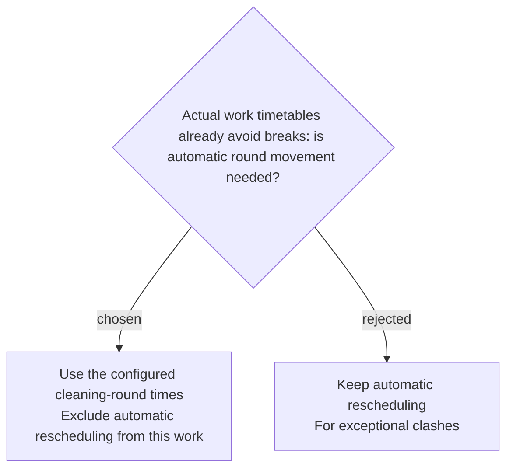

# Keep configured rounds without automatic break rescheduling

On 2026-11-16 the owner selected A after clarifying that actual work timetables are already arranged not to conflict with breaks. Keep the configured cleaning-round times and do not add automatic break-driven round rescheduling in this work. This explicitly supersedes [facility-0162](facility-0162-cleaning-rounds-move-automatically-when-breaks-conflict.md), which arose from a hypothetical clash that did not match the stated field practice.

The point-specific windows and existing placement/status/inspection semantics in [facility-0047](facility-0047-cleaning-rounds-are-time-windows.md) remain the baseline. New first-break groups and selected-date changes do not automatically rewrite recurring point settings, create per-day moved windows, or move deadlines based on actual early/late scans. The full two-break requirement and actual-time policy still follow [facility-0146](facility-0146-two-breaks-use-six-scanned-attendance-actions.md), [facility-0148](facility-0148-first-break-staggered-second-break-shared-before-ot.md) and [facility-0149](facility-0149-break-scans-record-actual-times-against-plan.md).

Remove automatic movement scope/duration/collision/overflow questions and implementation work from this design branch. A new timetable-conflict warning or hard save validation has not been approved by this answer; those must not be added as an assumed substitute feature. The two deferred Supervisor questions and other scheduling/attendance details remain open.

Accepted design decision only; no application, schema, database, point settings, mockup source or runtime changes have been made. This does not approve a spec, implementation plan or implementation.
