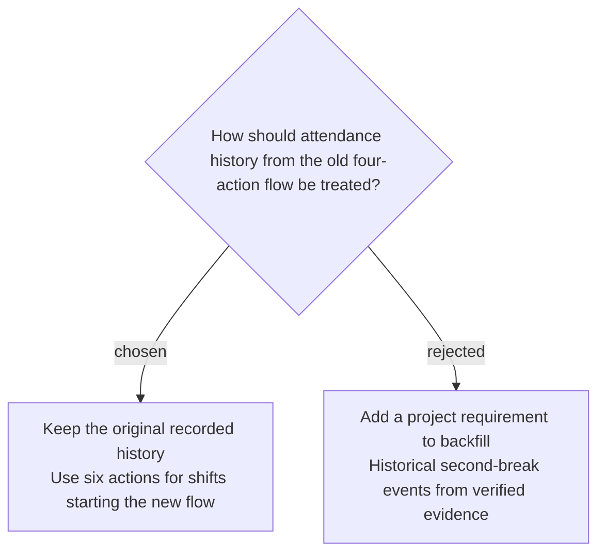

# Preserve legacy four-action attendance history when six-action shifts begin

On 2026-11-16 the owner selected A: keep older attendance history in its original four-action form and begin the six-action lifecycle for shifts that start using the new flow. Do not invent second-break records or flag an old shift as missing break-2 scans solely because that requirement did not exist in the old application.

This completes the legacy-history policy left open in [facility-0146](facility-0146-two-breaks-use-six-scanned-attendance-actions.md). Keep actual old event types and times; do not silently rename an old unnumbered break as a verified first or second break. Existing genuinely missing old events can still be recognized according to the old lifecycle. The decision does not waive missing-event checks in new six-action shifts.

No routine historical second-break backfill is required by this work. Existing correction provenance and permissions remain governed by their accepted scope; this answer does not grant new retrospective editing rights, add retention or recreate deleted history.

Before spec approval, define how a shift is identified as old versus new, the cutover treatment of already-started shifts and pre-update callers, and how read/export/correction paths use the appropriate expected actions. This is not permission to globally require new break identifiers from unrelated or legacy callers.

Accepted design only; no application, schema, database, stored attendance or runtime changes have been made.

Amendment 2026-11-17: [0168](facility-0168-six-action-attendance-starts-at-a-shift-boundary.md) resolves the shift-boundary cutover policy; [0169](facility-0169-refresh-stale-attendance-pages-for-new-flow.md) resolves stale-page compatibility for new-flow attendance. The preceding spec questions about cutover policy are resolved by these decisions; persistence/protocol details and read/export/correction integration still need definition in the spec.
