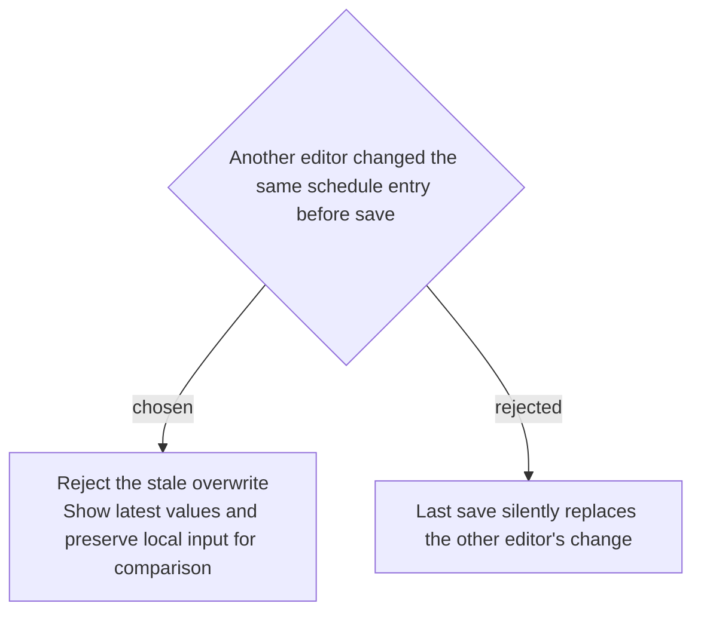

# Scheduling rejects stale overwrites and preserves local input

On 2026-11-17 the owner accepted the proposed save-protection set: when a Supervisor or Admin saves an entry based on older data, do not silently overwrite a newer change to that same entry. Show the latest saved values and preserve the unsaved local input for comparison before another explicit save. Preserving input does not mean storing a shared draft or automatically merging it.

Apply this guarantee to the new scheduling writes. It does not decide a version-token/table design, require unrelated existing endpoints to accept new inputs, widen editing authority, or resolve the deferred field rules for competing assignments and changes after work starts. See [the requirements record](../requirements-gathering/2026-11-16-supervisor-scheduling-requirements.md). Accepted design only; no application changes.

Amendment 2026-11-17: [0171](facility-0171-schedule-refresh-preserves-unsaved-input.md) also preserves input when a live refresh arrives before saving, with a notification that newer saved data exists. This complements stale-write rejection; it does not replace it or authorize automatic merging.
