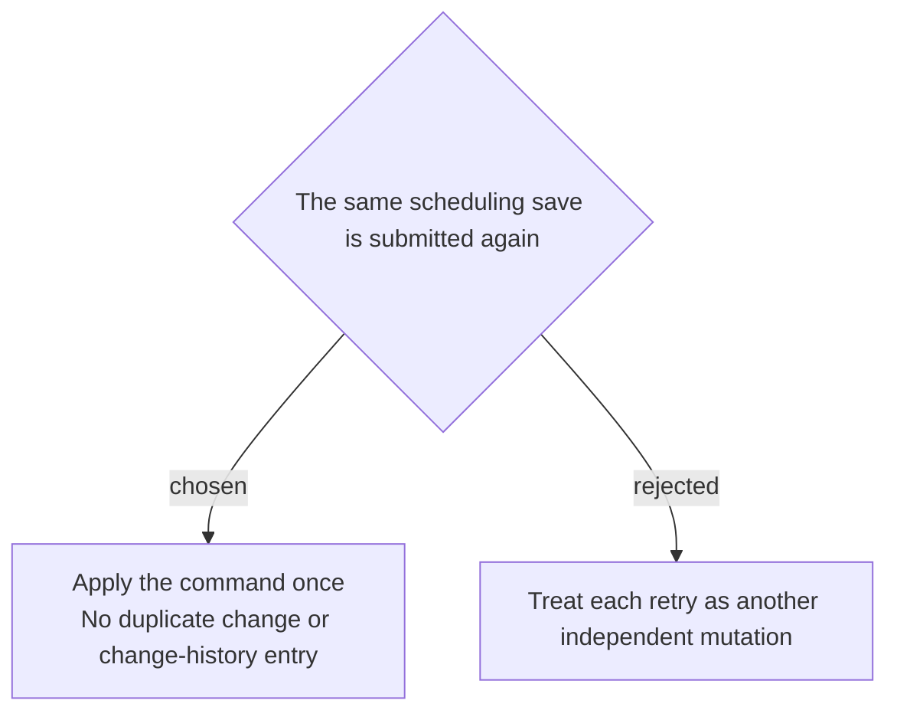

# A repeated scheduling save command applies once

On 2026-11-17 the owner accepted the proposed save-protection set: repeated submissions of the same scheduling save command, such as double clicks or retries on a slow connection, must apply once. A retry must not create duplicate scheduling changes or duplicate change-history entries.

This is scoped to the new scheduling commands, not an equality rule that combines different users' intentions or a ban on later deliberate edits. The spec must define command identity, retry recognition and retention of the result; no key format or persistence mechanism is selected here. Current cover-assignment duplicate checks alone do not establish this guarantee. See [0165](facility-0165-scheduling-rejects-stale-overwrites.md) for stale edits and [0167](facility-0167-check-uncertain-schedule-save-before-retry.md) for uncertain outcomes. Accepted design only; no application changes.

**Receipt mechanism selected:** [0221](facility-0221-schedule-commands-use-revisions-and-durable-receipts.md) defines the identity/fingerprint/atomic result basis. Expiry must not make an old committed command applicable again.
