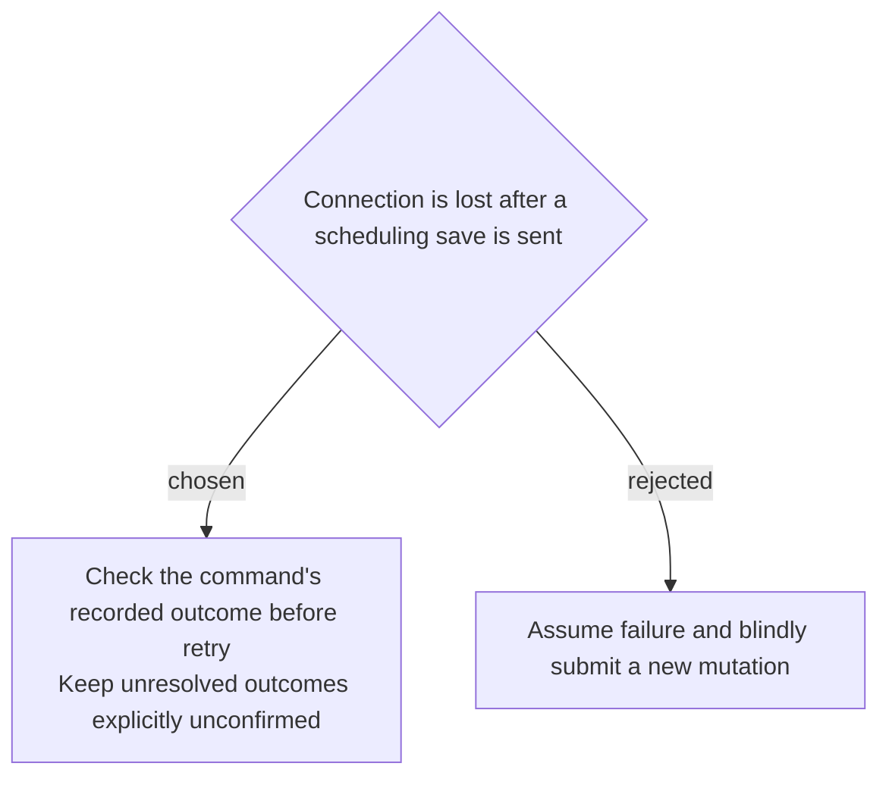

# Resolve an uncertain scheduling save before retrying

On 2026-11-17 the owner accepted the proposed save-protection set: if a connection fails after sending a scheduling save, verify whether that command committed before attempting another mutation. Until its outcome can be established, do not report success or definite failure; show that confirmation is pending. Preserve the local input for comparison/recovery without implying that it has been saved.

Use the same-command protection in [0166](facility-0166-repeated-schedule-save-applies-once.md); a newer conflicting edit still follows [0165](facility-0165-scheduling-rejects-stale-overwrites.md). This does not add offline scheduling, automatic background edits, a field approval step, or a requirement on unrelated endpoints. The lookup/retry mechanism remains for the spec. Accepted design only; no application changes.

**Recovery mechanism selected:** [0221](facility-0221-schedule-commands-use-revisions-and-durable-receipts.md) provides scoped command-result reads; uncertainty never triggers blind new mutation and purged/expired results do not imply retry safety.
