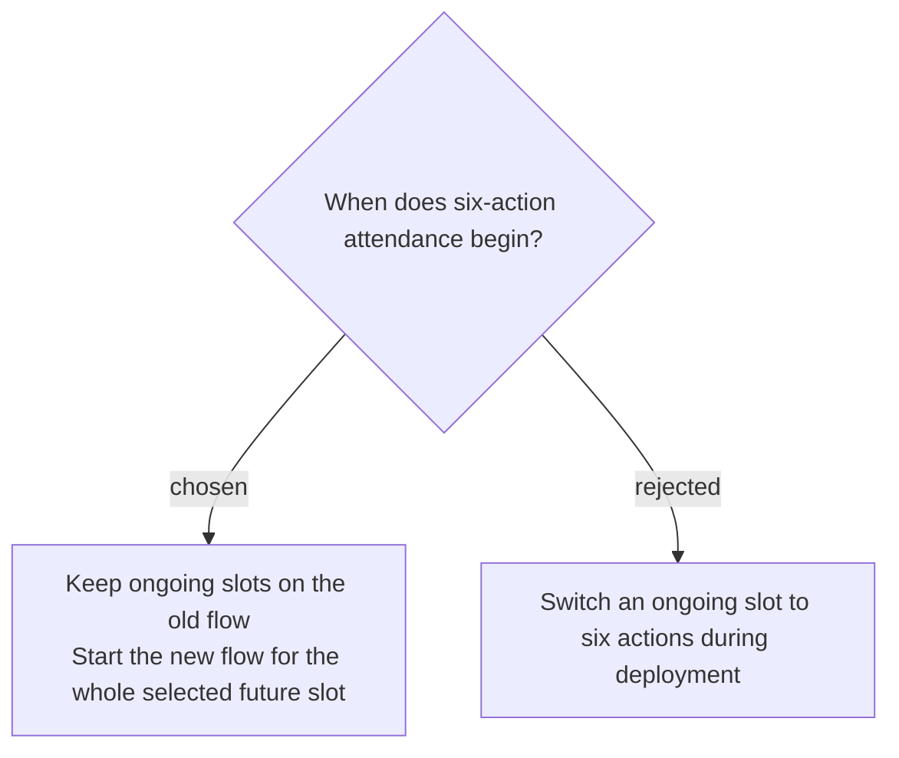

# Six-action attendance starts at an explicit shift boundary

On 2026-11-17 the owner accepted the recommended cutover set: an ongoing shift finishes under its original four-action lifecycle. Start six-action expectations together for the users of an explicitly selected future shift slot, rather than switching people within one slot at different times. For example, deployment at 13:00 may leave that day's day shift on four actions and start six actions with the night shift; this is illustrative, not an approved deployment time.

Prepare the cutover before the selected slot's attendance receiving window opens, including early check-in. A slot that already received old-flow attendance is unsuitable as the new-flow starting slot. Preserve the existing own-shift attribution, night-shift start date and configurable before/after receiving windows; scheduled shift end does not immediately end the receiving window of an old-flow slot.

This resolves the cutover policy left open in [0164](facility-0164-preserve-legacy-four-action-attendance-history.md). Old-flow slots, including late attendance/corrections within their existing permissions, retain their expected actions; do not reinterpret unnumbered old breaks as verified new break numbers. The actual activation slot and persistence mechanism remain for the spec/deployment preparation. Stale callers follow [0169](facility-0169-refresh-stale-attendance-pages-for-new-flow.md). Accepted design only; no deployment, code or database change.
