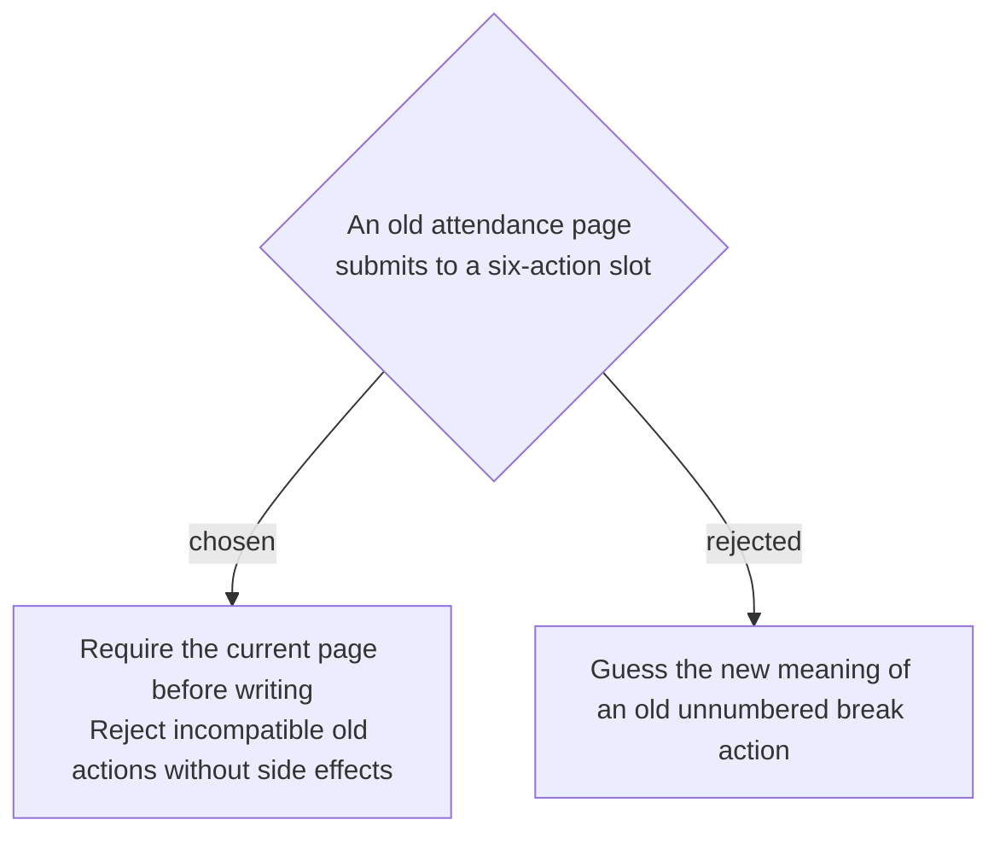

# Stale attendance pages refresh before new-flow writes

On 2026-11-17 the owner accepted the recommended cutover set: a pre-update attendance page must load the current page before recording attendance in a slot using the new six-action flow. Incompatible stale submissions must not write events or fabricate the missing new information. Explain that the page needs updating; do not silently guess which numbered break an old action means.

Scope the new compatibility requirement to the attendance paths consuming the changed contract. Calls for old-flow slots remain compatible with their old lifecycle under [0168](facility-0168-six-action-attendance-starts-at-a-shift-boundary.md); unrelated existing endpoints do not acquire a mandatory new field. The server determines the slot's applicable lifecycle rather than trusting a client to opt out. The exact version/capability representation and refresh mechanism remain for the spec. This decision adds no inspection rights, scan timing restrictions or field approval steps. Accepted design only; no application changes.
