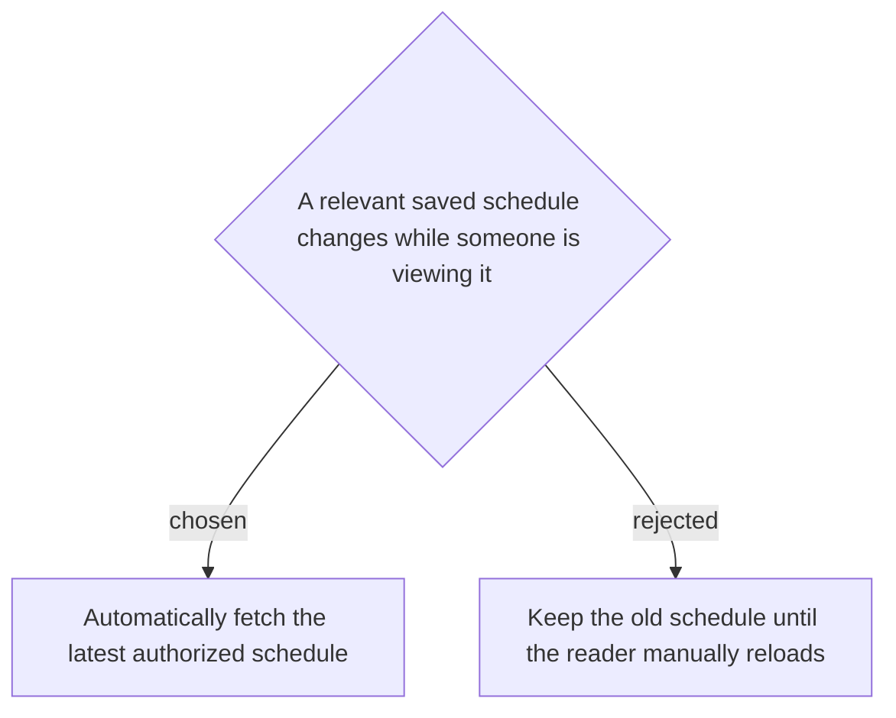

# Open schedule views refresh automatically after relevant changes

On 2026-11-17 the owner accepted the recommended schedule-freshness set: an open read-only schedule view automatically loads the latest saved schedule after a relevant change. For example, a Cleaner viewing tomorrow's Area assignment sees the responsible Supervisor's saved change without manually reloading.

Preserve own-only Cleaner reads and assigned-building/shift Supervisor scope. Refresh through authorized reads; an update event is not permission to see another person's schedule. This concerns open pages, not background push, email or SMS. Transport, fallback and timing remain for the spec; existing My Work live updates do not mean scheduling updates already exist. Editors follow [0171](facility-0171-schedule-refresh-preserves-unsaved-input.md) and connection recovery follows [0172](facility-0172-schedule-views-show-staleness-and-refetch-on-reconnect.md). Accepted design only; no application changes or mid-shift transfer policy is selected.
